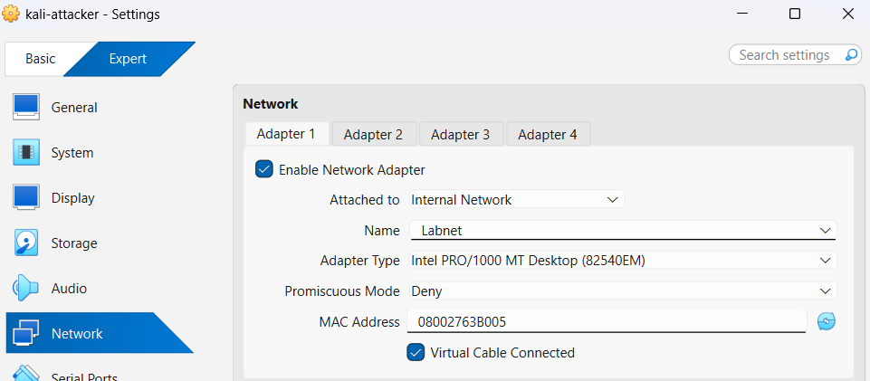
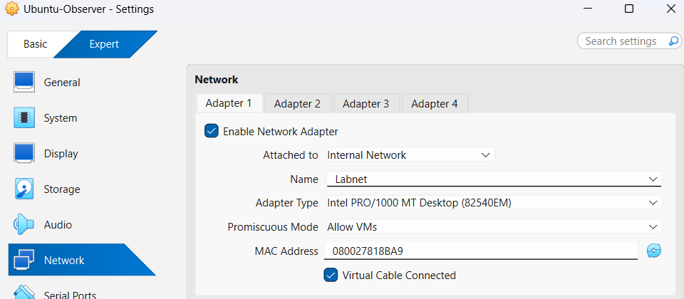
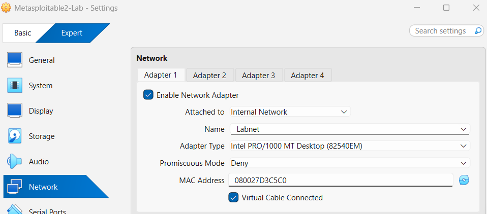
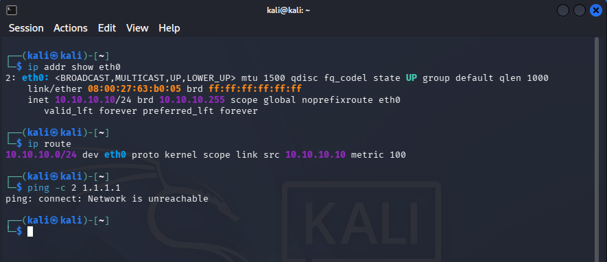
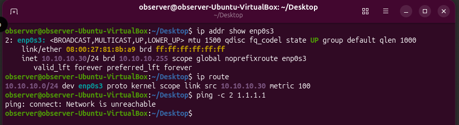
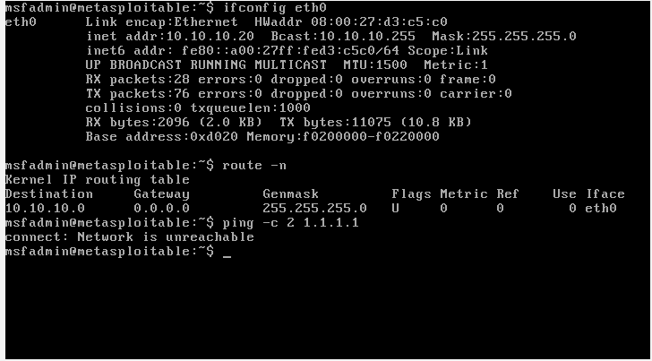
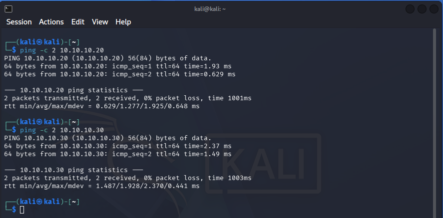
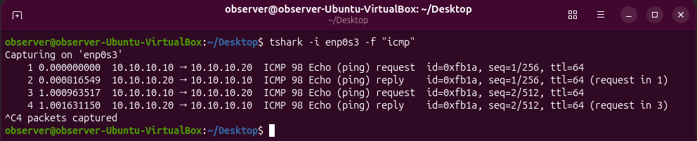

# Lab 01 - Isolated Cybersecurity Lab Environment

## Objective

The goal of this lab was to create an isolated environment for practicing offensive and defensive cybersecurity techniques without exposing intentionally vulnerable systems to my home network or the Internet.

The environment uses three virtual machines:

- Kali Linux - attacker
- Ubuntu - network observer and packet analysis system
- Metasploitable 2 - intentionally vulnerable target

All three systems communicate through a VirtualBox Internal Network named `Labnet`.

## Host Environment

The lab runs on a Windows 11 host using Oracle VirtualBox.

The host system is used to manage the virtual machines and documentation, while the security testing itself is performed inside the isolated virtual environment.

## Kali Linux Attacker Setup

I used a Kali Linux virtual machine as the attacker system.

Before moving Kali onto the isolated lab network, I temporarily gave it Internet access so I could check that the tools I wanted were installed and update the system before taking it offline.

I updated Kali using:

```bash
sudo apt update
sudo apt full-upgrade
```

This refreshed the package information and installed the available system and tool updates before the VM was isolated.

After updating Kali, I verified that the main tools I planned to use were available, including:

- Nmap
- Wireshark / TShark
- tcpdump
- Metasploit Framework
- Netcat
- John the Ripper
- Hashcat

Once Kali was updated and the required tools were available, I shut the VM down so it could be moved onto the isolated lab network.

## Ubuntu Observer Setup

I created an Ubuntu virtual machine to act as a network observer and packet analysis system.

Before moving the Observer onto the isolated lab network, I temporarily connected it to the Internet so I could update the system and install the monitoring tools I planned to use.

I updated Ubuntu using:

```bash
sudo apt update
sudo apt upgrade
```

I then installed Wireshark and TShark:

```bash
sudo apt install wireshark tshark
```

After installation, I tested packet capture and found that the `observer` account could not capture traffic without elevated privileges.

I checked the account permissions and added `observer` to the `wireshark` group:

```bash
sudo usermod -aG wireshark observer
```

The `-aG` options add the account to the specified group without removing its existing group memberships.

After adding the account to the `wireshark` group, I logged out and back in so the new group membership would take effect. I then verified the account's group membership with:

```bash
groups
```

I also confirmed that the available packet-capture interfaces could be accessed with:

```bash
dumpcap -D
```

After confirming that the Observer could capture packets without running Wireshark as root, I shut the VM down so it could be moved onto the isolated lab network.

## Metasploitable 2 Target Setup

I used Metasploitable 2 as the intentionally vulnerable target system for the lab.

I downloaded the Metasploitable 2 archive on the Windows 11 host from the official Rapid7-linked SourceForge page.

Before extracting the archive, I verified its SHA-256 hash using PowerShell:

```powershell
Get-FileHash .\metasploitable-linux-2.0.0.zip -Algorithm SHA256
```

I compared the resulting hash with the value provided by the download source to confirm that the archive had not been altered or corrupted.

After verifying the download, I extracted the files and created a new VirtualBox VM using the provided `Metasploitable.vmdk` virtual disk rather than installing an operating system from an ISO.

Because Metasploitable is intentionally vulnerable, I configured its VirtualBox network adapter to use the isolated `Labnet` Internal Network before starting the VM for the first time.

This kept the vulnerable target separated from the Internet and my home network from the start.

## Isolated Network Configuration

After preparing the three virtual machines, I configured them to communicate through a VirtualBox Internal Network named `Labnet`.

The lab uses the `10.10.10.0/24` network with the following static IP addresses:

| System | Role | IP Address |
|---|---|---|
| Kali Linux | Attacker | 10.10.10.10/24 |
| Ubuntu Observer | Packet Analysis / Monitoring | 10.10.10.30/24 |
| Metasploitable 2 | Vulnerable Target | 10.10.10.20/24 |

VirtualBox Internal Network mode allows the virtual machines attached to `Labnet` to communicate with each other without connecting that network to the Windows host's normal network or the Internet.

No default gateway or DNS server was configured on the lab systems because they only needed to communicate with other machines inside the `10.10.10.0/24` subnet.

### VirtualBox Network Settings

Each virtual machine's primary network adapter was attached to the VirtualBox Internal Network named `Labnet`.

Kali was configured with:

- Attached to: `Internal Network`
- Name: `Labnet`
- Promiscuous Mode: `Deny`



The Ubuntu Observer was configured with:

- Attached to: `Internal Network`
- Name: `Labnet`
- Promiscuous Mode: `Allow VMs`

`Allow VMs` lets the Observer capture traffic exchanged between other virtual machines on `Labnet`, which is necessary for its monitoring role.



Metasploitable 2 was configured with:

- Attached to: `Internal Network`
- Name: `Labnet`
- Promiscuous Mode: `Deny`



### Kali Network Configuration

I configured Kali with a static IPv4 address so the attacker system would always have the same address within the lab.

Kali uses NetworkManager to manage its network connections. I first checked which connection profile was active using:

```bash
nmcli connection show --active
```

The output showed that `Wired connection 1` was the active Ethernet profile associated with `eth0`.

I then inspected the profile using:

```bash
nmcli connection show "Wired connection 1"
```

Based on the lab design, Kali needed a fixed IPv4 address, no DHCP-assigned configuration, no gateway or DNS server, no default route, and no IPv6 connection. I used the corresponding NetworkManager settings to configure the profile:

```bash
sudo nmcli connection modify "Wired connection 1" \
ipv4.method manual \
ipv4.addresses "10.10.10.10/24" \
ipv4.gateway "" \
ipv4.dns "" \
ipv4.never-default yes \
ipv6.method disabled
```

The main settings used were:

- `ipv4.method manual` - uses a manually assigned IPv4 configuration instead of DHCP.
- `ipv4.addresses "10.10.10.10/24"` - assigns Kali the static address `10.10.10.10` on the `10.10.10.0/24` lab subnet.
- `ipv4.gateway ""` - leaves the gateway blank because Kali does not need to route traffic outside the lab subnet.
- `ipv4.dns ""` - leaves DNS blank because the lab systems communicate directly using IP addresses.
- `ipv4.never-default yes` - prevents this connection from becoming Kali's default network route.
- `ipv6.method disabled` - disables IPv6 for the lab connection.

I applied the updated network profile using:

```bash
sudo nmcli connection up "Wired connection 1"
```

I verified the final interface configuration and routing table with:

```bash
ip addr show eth0
ip route
```

I also tested an external IP address to confirm that Kali did not have a route outside the lab:

```bash
ping -c 2 1.1.1.1
```



The output confirms that Kali is using `10.10.10.10/24`, has a route for the local `10.10.10.0/24` network, has no default route, and cannot reach the external address `1.1.1.1`.

### Ubuntu Observer Network Configuration

I configured the Ubuntu Observer with a static IPv4 address so the monitoring system would always have the same address within the lab.

Ubuntu uses NetworkManager to manage its network connections, so I first checked which connection profile was active using:

```bash
nmcli connection show --active
```

The output showed that `netplan-enp0s3` was the active Ethernet profile associated with the `enp0s3` interface.

I then inspected that profile using:

```bash
nmcli connection show "netplan-enp0s3"
```

Based on the lab design, the Observer needed a fixed IPv4 address, no gateway or DNS server, no default route, and IPv6 disabled.

I configured the connection using:

```bash
sudo nmcli connection modify "netplan-enp0s3" \
ipv4.method manual \
ipv4.addresses "10.10.10.30/24" \
ipv4.gateway "" \
ipv4.dns "" \
ipv4.never-default yes \
ipv6.method disabled
```

The main settings used were:

- `ipv4.method manual` - uses a manually assigned IPv4 configuration instead of DHCP.
- `ipv4.addresses "10.10.10.30/24"` - assigns the Observer the static address `10.10.10.30` on the `10.10.10.0/24` lab subnet.
- `ipv4.gateway ""` - leaves the gateway blank because the Observer does not need to route traffic outside the lab subnet.
- `ipv4.dns ""` - leaves DNS blank because the lab systems communicate directly using IP addresses.
- `ipv4.never-default yes` - prevents this connection from becoming the Observer's default network route.
- `ipv6.method disabled` - disables IPv6 for the lab connection.

I applied the updated network profile using:

```bash
sudo nmcli connection up "netplan-enp0s3"
```

After testing the configuration, I found that Ubuntu was not consistently keeping the static network settings. Because Ubuntu was also using Netplan to define the interface configuration, I inspected the Netplan files to determine why the settings were not persisting:

```bash
sudo cat /etc/netplan/*.yaml
```

I found that an installer-generated Netplan file still had DHCP enabled:

```yaml
dhcp4: true
dhcp6: true
```

This conflicted with the static-only configuration I had set through NetworkManager, so I changed the values to:

```yaml
dhcp4: false
dhcp6: false
```

I then validated and applied the updated Netplan configuration:

```bash
sudo netplan generate
sudo netplan apply
```

After this change, the static network configuration remained in place.

I verified the final interface configuration and routing table with:

```bash
ip addr show enp0s3
ip route
```

I also tested an external IP address to confirm that the Observer did not have a route outside the lab:

```bash
ping -c 2 1.1.1.1
```



The output confirms that the Observer is using `10.10.10.30/24`, has a route only for the local `10.10.10.0/24` network, has no default route, and cannot reach the external address `1.1.1.1`.

### Metasploitable 2 Network Configuration

I configured Metasploitable 2 with a static IPv4 address so the vulnerable target would always use the same address within the lab.

Metasploitable 2 uses `/etc/network/interfaces` for its network configuration.

I checked the existing configuration with:

```bash
cat /etc/network/interfaces
```

The `eth0` interface was configured to use DHCP, so I edited the file with:

```bash
sudo nano /etc/network/interfaces
```

I changed the interface from DHCP to static and assigned the lab address and subnet mask:

```text
auto eth0
iface eth0 inet static
    address 10.10.10.20
    netmask 255.255.255.0
```

Using a static configuration keeps the target at the known address `10.10.10.20` instead of relying on DHCP to assign one.

No gateway or DNS server was added because the target only needed to communicate within the isolated lab network.

I applied the new configuration by bringing `eth0` down and back up:

```bash
sudo ifdown eth0 && sudo ifup eth0
```

I verified the final interface configuration and routing table with:

```bash
ifconfig eth0
route -n
```

I also tested an external IP address to confirm that Metasploitable did not have a route outside the lab:

```bash
ping -c 2 1.1.1.1
```



The output confirms that Metasploitable is using `10.10.10.20` with the `255.255.255.0` subnet mask, has no default route, and cannot reach the external address `1.1.1.1`.

## Network Validation

After configuring all three systems, I tested communication between the virtual machines on `Labnet`.

From Kali, I pinged both the Metasploitable target and the Ubuntu Observer:

```bash
ping -c 2 10.10.10.20
ping -c 2 10.10.10.30
```

Both systems responded successfully, confirming that the three virtual machines could communicate within the isolated `10.10.10.0/24` network.



Combined with the earlier external connectivity tests, this confirmed that the lab systems could communicate with each other while remaining isolated from networks outside `Labnet`.

## Traffic Monitoring Validation

After confirming connectivity between the lab systems, I tested whether the Ubuntu Observer could monitor traffic exchanged between Kali and Metasploitable.

On the Observer, I started a TShark capture on the `enp0s3` interface and filtered the capture to ICMP traffic:

```bash
tshark -i enp0s3 -f "icmp"
```

While the capture was running, I sent ICMP echo requests from Kali to Metasploitable:

```bash
ping -c 2 10.10.10.20
```

The Observer captured both the echo requests from `10.10.10.10` to `10.10.10.20` and the replies from `10.10.10.20` back to `10.10.10.10`.



Because neither side of this communication was the Observer itself, this confirmed that the Observer's `Allow VMs` promiscuous-mode setting was working and that it could monitor traffic exchanged between the other systems on `Labnet`.

## Baseline Snapshots

After validating the network configuration, connectivity, isolation, and traffic monitoring, I shut down all three virtual machines and created a powered-off baseline snapshot named `Labnet ready` for each VM.

These snapshots provide a known working state that I can return to before or after future security exercises without having to rebuild the lab environment.

## Result

The final lab environment successfully provides an isolated network for future offensive and defensive security exercises.

Kali, the Ubuntu Observer, and Metasploitable 2 can communicate with each other through `Labnet`, while VirtualBox Internal Network mode and the lack of a default route keep the lab systems isolated from outside networks.

The Ubuntu Observer can also capture traffic exchanged between Kali and Metasploitable, allowing future exercises to be viewed from both an attacker and network-monitoring perspective.

## What I Learned

Building this environment gave me a better understanding of how virtual networking and Linux network configuration work together.

I learned how VirtualBox Internal Network mode can be used to keep vulnerable systems separated from my normal network, and why static IP addresses, no default gateway, and no DNS configuration make sense for a small isolated lab.

I also got experience configuring networking in three different ways: NetworkManager with `nmcli` on Kali, Netplan with NetworkManager on Ubuntu, and `/etc/network/interfaces` on the older Metasploitable system.

Troubleshooting the Ubuntu Observer also showed me the importance of checking the underlying configuration when settings do not behave as expected instead of assuming the first configuration change worked.

Finally, setting up the Observer and verifying that it could capture traffic between Kali and Metasploitable helped me better understand promiscuous mode and how a separate monitoring system can be used to observe traffic during future security exercises.

## References

- [Oracle VirtualBox Documentation](https://www.virtualbox.org/manual/)
- [Kali Linux Documentation](https://www.kali.org/docs/)
- [Kali Linux Tools](https://www.kali.org/tools/)
- [Ubuntu Documentation](https://documentation.ubuntu.com/)
- [NetworkManager Documentation](https://networkmanager.dev/docs/)
- [Netplan Documentation](https://netplan.readthedocs.io/)
- [Wireshark Documentation](https://www.wireshark.org/docs/)
- [Rapid7 Metasploitable 2](https://docs.rapid7.com/metasploit/metasploitable-2/)
