# Lab 02 - Network Discovery and Port Scanning

## Objective

The goal of this lab is to use Nmap to discover active hosts and identify open TCP and UDP ports within the isolated network created in [Lab 01](../01-isolated-lab-environment/).

Wireshark will also be used to capture and analyze the traffic generated during scanning to better understand how host discovery and port scanning work at the packet level.

## Lab Environment

This lab uses the three virtual machines configured in [Lab 01](../01-isolated-lab-environment/).

| Virtual Machine | IP Address | Role |
|---|---|---|
| Kali Linux | `10.10.10.10` | Scanning system used for network discovery and port scanning. |
| Metasploitable 2 | `10.10.10.20` | Intentionally vulnerable target used for network discovery and port scanning. |
| Ubuntu | `10.10.10.30` | Network observer running Wireshark to capture and analyze traffic. |

All three systems communicate through the VirtualBox Internal Network named `Labnet`, using the `10.10.10.0/24` subnet.

The network remains isolated from the host's normal network and the Internet.

## Methodology

I began by validating network connectivity and discovering active hosts, followed by TCP and UDP port scanning.

I used Nmap on Kali Linux to scan the lab network and Metasploitable 2. Wireshark was used on the Ubuntu Observer to capture and examine the traffic generated during these scans.

Before each scan, I reviewed the relevant commands and options to understand their purpose. After running each scan, I compared the Nmap results with the captured packets to understand how the responses determined port states.

The commands, observations, and screenshots were documented throughout the lab.

## 1. Network Validation

Before beginning the scans, I verified that the three virtual machines retained their network configurations from [Lab 01](../01-isolated-lab-environment/).

On Kali, I checked the IP address and routing table using:

```bash
ip address show dev eth0
ip route
```

On the Ubuntu Observer, I used the same commands with its `enp0s3` network interface:

```bash
ip address show dev enp0s3
ip route
```

On Metasploitable 2, I used:

```bash
ifconfig eth0
route -n
```

All three systems retained their assigned static IP addresses on the `10.10.10.0/24` subnet. Each system had a route to the local network and no default gateway configured.

I then tested connectivity from Kali to Metasploitable 2 and the Ubuntu Observer:

```bash
ping -c 2 10.10.10.20
ping -c 2 10.10.10.30
```

Both systems responded successfully with 0% packet loss.


I also tested connectivity from the Ubuntu Observer to Metasploitable 2:

```bash
ping -c 2 10.10.10.20
```

All three systems responded successfully to the connectivity tests, confirming that they could communicate within the isolated lab network and were ready for scanning.

## 2. Host Discovery

After confirming network connectivity, I used Nmap on Kali Linux to identify active hosts on the `10.10.10.0/24` network.

Before starting the scan, I opened Wireshark on the Ubuntu Observer and began capturing traffic on the `enp0s3` interface.

I then ran the following command from Kali:

```bash
nmap -sn 10.10.10.0/24
```

The `-sn` option tells Nmap to perform host discovery without conducting a port scan. The `10.10.10.0/24` argument specifies the network to scan.

Nmap scanned 256 IP addresses and identified three active hosts:

| IP Address | System | MAC Address |
|---|---|---|
| 10.10.10.10 | Kali Linux | Local scanning system |
| 10.10.10.20 | Metasploitable 2 | 08:00:27:d3:c5:c0 |
| 10.10.10.30 | Ubuntu Observer | 08:00:27:81:8b:a9 |

The scan identified all three virtual machines on the isolated lab network.


### ARP Traffic Analysis

After completing the scan, I examined the captured traffic in Wireshark.

Because the systems were connected to the same local Ethernet network, Nmap used Address Resolution Protocol (ARP) requests to discover active hosts.

The capture showed Kali broadcasting ARP requests across the subnet, asking which devices were associated with specific IP addresses.

For example, Kali sent the following request for Metasploitable 2:

`Who has 10.10.10.20? Tell 10.10.10.10`

Metasploitable responded with its MAC address:

`10.10.10.20 is at 08:00:27:d3:c5:c0`

A similar exchange occurred with the Ubuntu Observer at `10.10.10.30`.


I inspected the Ethernet and ARP headers to examine how the requests and replies were structured.

The ARP requests used the Ethernet broadcast destination `ff:ff:ff:ff:ff:ff`, allowing devices on the local network to receive them.

The replies were sent directly to Kali's MAC address and contained the responding systems' IP and MAC addresses.

The ARP headers distinguished the two message types using their operation codes:

- Request: Opcode 1
- Reply: Opcode 2

I also noticed differences in the ARP traffic between the two systems. Metasploitable 2 received one ARP request and sent one reply, while Ubuntu received six requests and responded to all six.

Metasploitable 2's ARP reply was 60 bytes, including 18 bytes of Ethernet padding. All six Ubuntu replies were 42 bytes, with no padding present in the captured frames.

The captured traffic confirmed how Nmap used ARP responses to identify active systems and obtain their MAC addresses without performing a port scan.

## 3. TCP Port Scanning

After discovering the active hosts, I used Nmap on Kali Linux to scan TCP ports on Metasploitable 2 (`10.10.10.20`).

The objective was to identify open and closed TCP ports, compare different scanning techniques, and examine the corresponding network traffic in Wireshark.

### TCP SYN Scanning

I began with a targeted TCP SYN scan of five ports:

```bash
sudo nmap -sS -p 21,22,80,443,65000 10.10.10.20
```

The `-sS` option performs a TCP SYN scan, while `-p` specifies which ports to scan.

Nmap reported the following results:

| Port | State | Service |
|---|---|---|
| 21/tcp | open | ftp |
| 22/tcp | open | ssh |
| 80/tcp | open | http |
| 443/tcp | closed | https |
| 65000/tcp | closed | unknown |

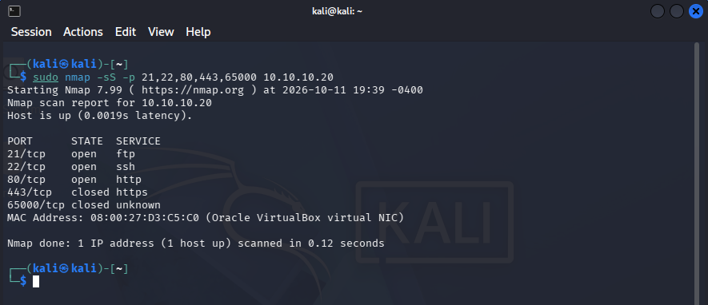

I captured the scan traffic using Wireshark on the Ubuntu Observer to examine how Nmap determined the port states.

For open ports, Kali sent a TCP SYN packet and Metasploitable responded with SYN-ACK. Kali then sent RST to terminate the attempted connection without completing the TCP three-way handshake.

For closed ports, Metasploitable responded to the SYN probe with RST-ACK, rejecting the connection attempt.

I examined the TCP headers for both responses in Wireshark.

The following capture shows the SYN-ACK response from port 22, indicating that the port was open.

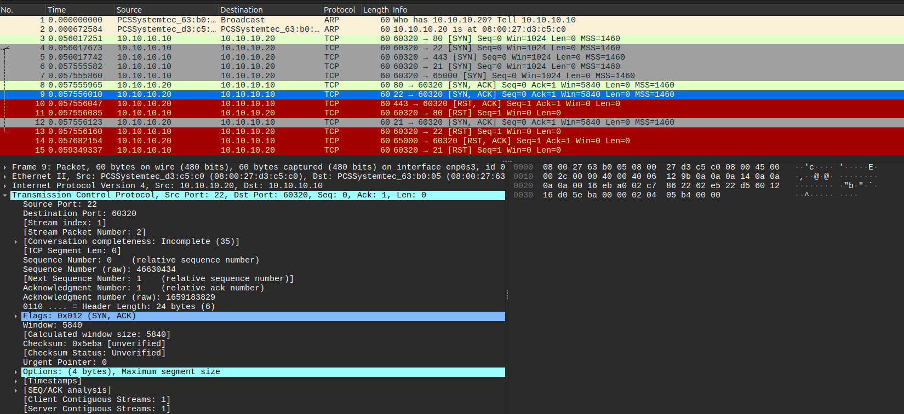

The next capture shows the RST-ACK response from port 443, indicating that the port was closed.

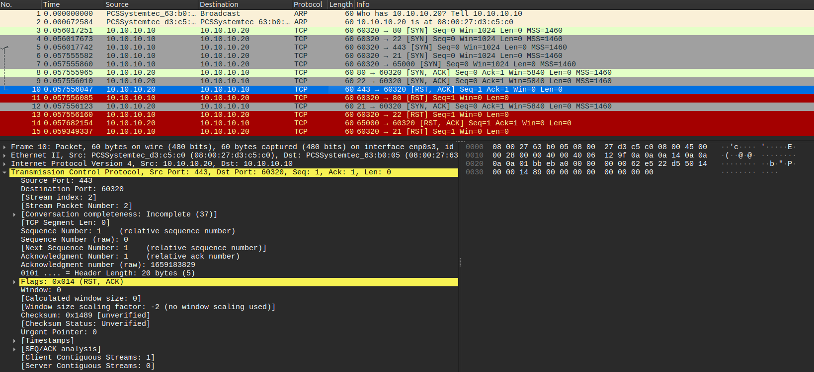

These responses demonstrated how Nmap distinguishes between TCP ports accepting connections and ports that are reachable but not accepting connections.

### TCP Connect Scanning

I also performed a TCP connect scan against port 22:

```bash
nmap -sT -p 22 10.10.10.20
```

The `-sT` option uses the operating system's TCP connection mechanism to establish a complete connection rather than performing a SYN-only scan.

Nmap reported port 22 as open.

The Wireshark capture showed the following sequence:

1. Kali sent SYN to port 22.
2. Metasploitable responded with SYN-ACK.
3. Kali sent ACK, completing the TCP three-way handshake.
4. Kali sent RST-ACK to terminate the connection.

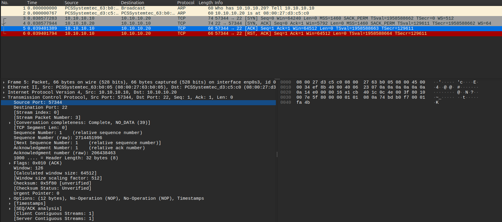

Unlike the SYN scan, the TCP connect scan completed the three-way handshake before terminating the connection. This difference was visible in the captured TCP packets.

### Default vs. Full TCP Port Scanning

After examining individual ports, I performed a broader TCP SYN scan using Nmap's default port selection:

```bash
sudo nmap -sS 10.10.10.20
```

By default, Nmap scans the 1,000 most commonly used TCP ports.

The scan identified 23 open ports and 977 closed ports.

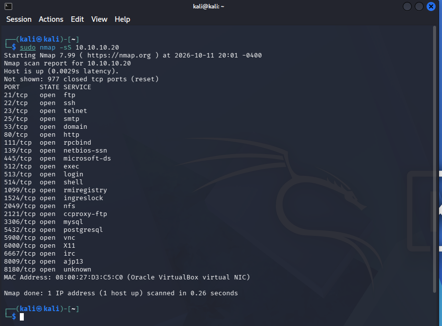

I then scanned the entire TCP port range:

```bash
sudo nmap -sS -p- 10.10.10.20
```

The `-p-` option specifies all 65,535 TCP ports.

The full scan identified 30 open ports and 65,505 closed ports.

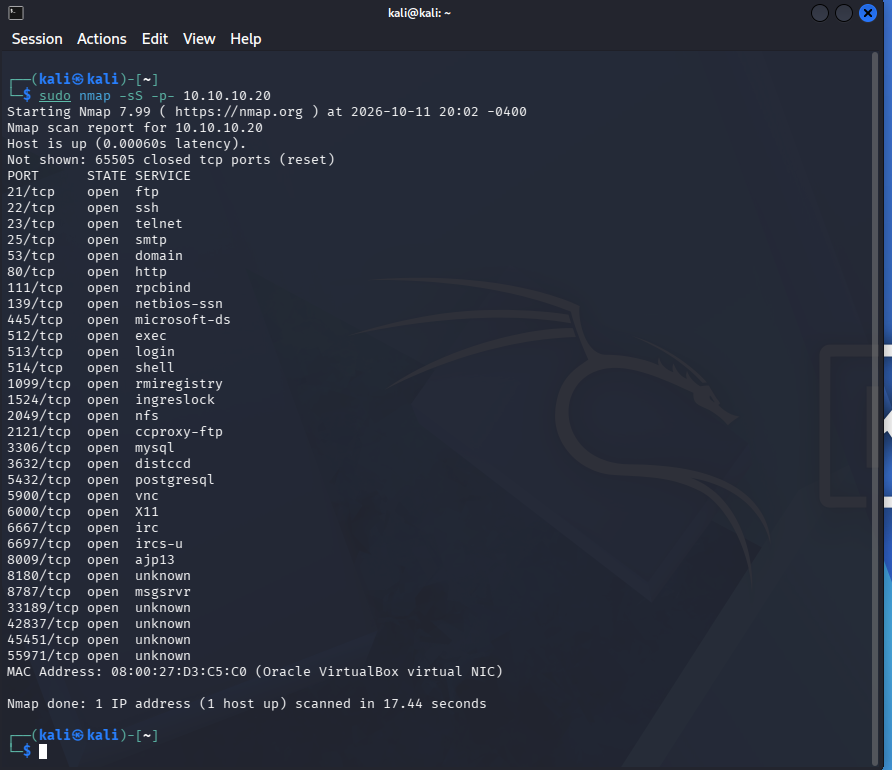

Comparing the two scans revealed seven additional open ports that were not included in the default scan:

| Port | Nmap Service Label |
|---|---|
| 3632/tcp | distccd |
| 6697/tcp | ircs-u |
| 8787/tcp | msgsrvr |
| 33189/tcp | unknown |
| 42837/tcp | unknown |
| 45451/tcp | unknown |
| 55971/tcp | unknown |

The full scan discovered 30 open TCP ports compared with 23 in the default scan, demonstrating that scanning only the default 1,000 ports can miss additional open ports.

The service names displayed by Nmap were based on known port associations rather than service/version detection. Identifying the actual services and software running on these ports will be covered in [Lab 03](../03-service-enumeration/).

### TCP ACK and FIN Scan Comparison

I also compared TCP ACK and FIN scanning techniques against port 22, which was open, and port 65000, which was closed.

First, I performed a TCP ACK scan:

```bash
sudo nmap -sA -p 22,65000 10.10.10.20
```

The `-sA` option sends TCP ACK probes to investigate whether traffic is being filtered. Unlike SYN scanning, it does not directly determine whether a port is open or closed.

Both ports were reported as `unfiltered`.

I then performed a TCP FIN scan:

```bash
sudo nmap -sF -p 22,65000 10.10.10.20
```

The `-sF` option sends TCP FIN probes without first establishing a connection.

The FIN scan reported port 22 as `open|filtered` and port 65000 as `closed`.

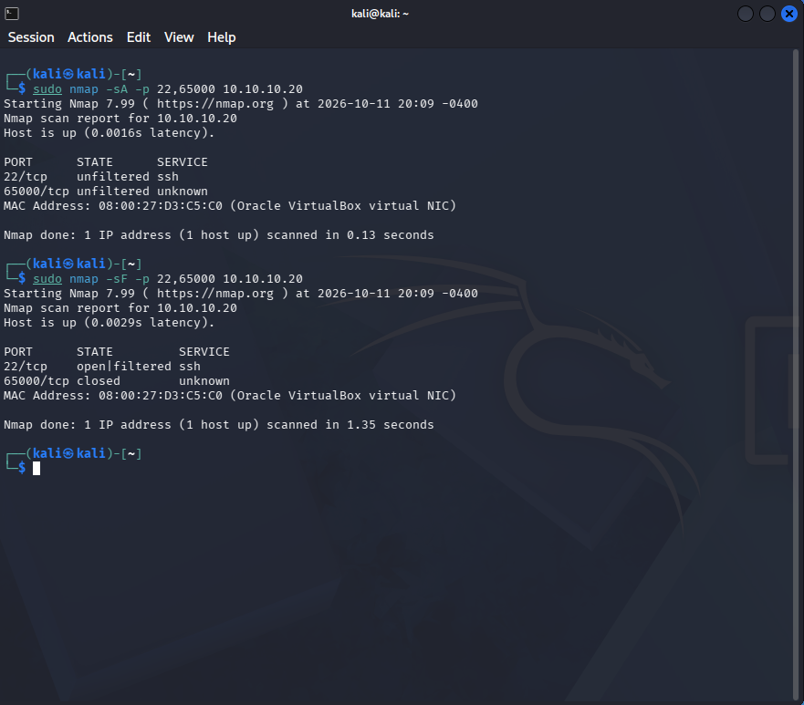

The results were compared with the earlier SYN scan:

| Port | SYN Scan | ACK Scan | FIN Scan |
|---|---|---|---|
| 22/tcp | open | unfiltered | open\|filtered |
| 65000/tcp | closed | unfiltered | closed |

I examined the ACK and FIN scan traffic in Wireshark to understand the differences in the responses.

During the ACK scan, both ports responded with TCP RST packets. Nmap classified both as `unfiltered`, despite one port being open and the other closed.

During the FIN scan, port 65000 responded with RST-ACK, while repeated FIN probes to port 22 received no response.

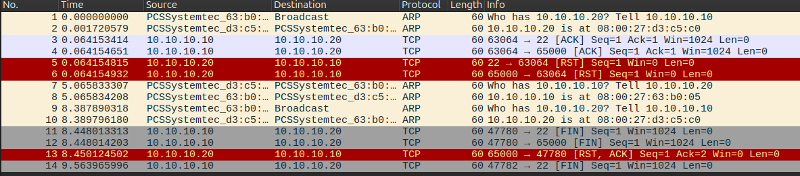

The `open|filtered` result for port 22 did not indicate that a firewall was blocking traffic. It meant Nmap could not determine whether the port was open and ignoring the FIN probes or whether the probes were being filtered.

These experiments demonstrated how different TCP scanning techniques can produce different classifications for the same ports, depending on the probes sent and responses received.

No ports were confirmed to be filtered during this lab. Testing how actual firewall filtering affects scan results was left for a future lab, since configuring firewall rules was outside the scope of this introductory port-scanning exercise.

## 4. UDP Port Scanning

After completing the TCP scans, I used Nmap to investigate UDP ports on Metasploitable 2 (`10.10.10.20`).

Unlike TCP, UDP does not use a connection handshake. Nmap relies on UDP responses, ICMP errors, and unanswered probes to determine port states.

### Targeted UDP Scanning

I began by scanning the same five port numbers used during the earlier TCP SYN scan:

```bash
sudo nmap -sU -p 21,22,80,443,65000 --reason 10.10.10.20
```

The `-sU` option performs a UDP scan, while `--reason` displays why Nmap assigned each port state.

| Port | TCP SYN Scan | UDP Scan |
|---|---|---|
| 21 | open | closed |
| 22 | open | closed |
| 80 | open | closed |
| 443 | closed | closed |
| 65000 | closed | closed |

All five UDP ports were closed, even though TCP ports 21, 22, and 80 were open. This demonstrated that TCP and UDP use separate port spaces, and an open TCP port does not mean the corresponding UDP port is also open.

I then scanned three ports associated with common UDP services:

```bash
sudo nmap -sU -p 53,69,161 --reason 10.10.10.20
```

| Port | State | Service Label | Reason |
|---|---|---|---|
| 53/udp | open | domain | udp-response |
| 69/udp | open\|filtered | tftp | no-response |
| 161/udp | closed | snmp | port-unreach |

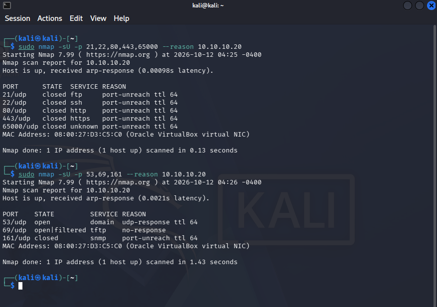

I captured both scans in Wireshark on the Ubuntu Observer to examine the responses:

- **UDP 53:** Metasploitable responded to Nmap's DNS queries, confirming the port was open.
- **UDP 69:** Kali sent TFTP probes, including read requests for `r7tftp.txt`, but received no response. Nmap reported `open|filtered` because it could not determine whether the port was open but silent or filtered.
- **UDP 161:** Metasploitable returned ICMP Type 3, Code 3 (Port Unreachable), indicating the port was closed.

The capture also showed Kali sending ICMP Port Unreachable messages after receiving DNS responses. These messages did not indicate that Metasploitable's DNS port was closed.

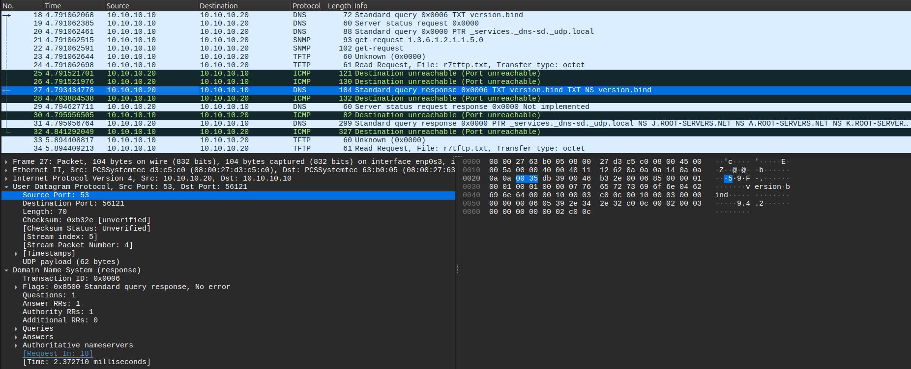

These results demonstrated why UDP scanning can be less conclusive than TCP scanning. Without a response, Nmap cannot always distinguish between an open port and filtered traffic.

### Top-20 UDP Scanning

After examining individual UDP ports, I performed a broader scan:

```bash
sudo nmap -sU --top-ports 20 --reason 10.10.10.20
```

The `--top-ports 20` option selects 20 commonly scanned UDP ports from Nmap's port-frequency database.

The scan identified 2 open ports, 13 closed ports, and 5 `open|filtered` ports.

The confirmed open ports were UDP 53 (DNS) and UDP 137 (NetBIOS Name Service).

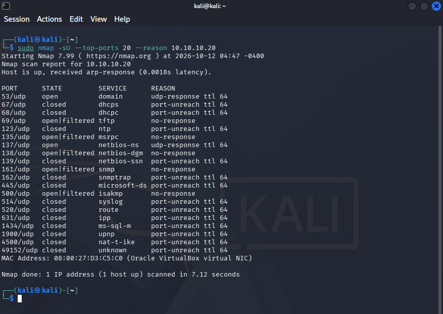

One difference from the targeted scan was UDP port 161. It was previously reported as `closed`, but the broader scan reported `open|filtered`.

During the targeted scan, Metasploitable returned an ICMP Port Unreachable message for UDP port 161, causing Nmap to report it as closed. During the top-20 scan, Nmap received no response and reported the same port as open|filtered. This demonstrates how UDP scan results can differ based on the responses received, without necessarily indicating a change in the actual port state.

#### NetBIOS Name Service Analysis

The top-20 scan also discovered UDP port 137 as open.

In Wireshark, I observed Kali sending NetBIOS Node Status (`NBSTAT`) queries and Metasploitable responding with its registered NetBIOS names.

One response contained seven name entries:

| Name | Registered Role |
|---|---|
| `METASPLOITABLE<00>` | Workstation/Redirector |
| `METASPLOITABLE<03>` | Messenger service/Main name |
| `METASPLOITABLE<20>` | Server service |
| `__MSBROWSE__` | Network browsing |
| `WORKGROUP<00>` | Workstation/Redirector |
| `WORKGROUP<1D>` | Local Master Browser |
| `WORKGROUP<1E>` | Browser Election Service |

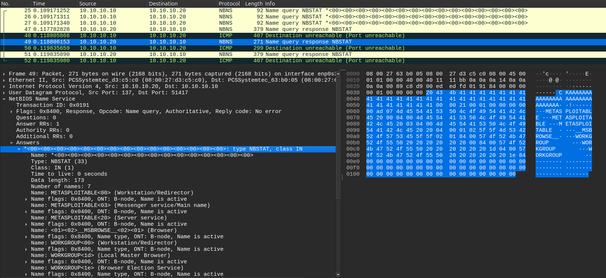

The NBNS response confirmed that UDP port 137 was open and revealed the target's computer name, workgroup, and registered network roles.

This introduced service enumeration, where responses from discovered ports can provide additional information about a target. The TCP and UDP ports identified in Lab 02 will be investigated further in [Lab 03](../03-service-enumeration/).

## 5. Findings

The network discovery scan identified all three virtual machines on the isolated `10.10.10.0/24` network.

The TCP scans identified 23 open ports during the default scan and 30 during the full scan, revealing seven additional ports outside Nmap's default selection.

The UDP scans confirmed ports 53 and 137 as open. Other UDP ports returned ICMP Port Unreachable errors or produced inconclusive `open|filtered` results. Port 161 also received different classifications between targeted and broader scans.

Wireshark confirmed the packet behavior behind these results. The NBNS response from UDP port 137 additionally revealed the target's registered computer name, workgroup, and network roles.

## Result

Successfully discovered the active hosts and identified open TCP and UDP ports on Metasploitable 2 using Nmap.

The Wireshark captures provided packet-level evidence of how Nmap determined port states. The identified ports will be used as a starting point for service enumeration in [Lab 03](../03-service-enumeration/).

## What I Learned

This lab helped me better understand how Nmap determines port states and how different scanning techniques affect the results.

Examining the TCP traffic in Wireshark made the differences between SYN and connect scans much clearer. Comparing ACK and FIN scans also showed me that a port can receive different classifications depending on the type of probe being sent.

I also learned why scanning beyond Nmap's default ports can be useful. The full TCP scan discovered seven additional open ports that the default scan missed.

UDP scanning was more difficult to understand at first because it does not have a connection handshake like TCP. Examining DNS responses, ICMP Port Unreachable errors, and unanswered TFTP probes helped me understand why Nmap can identify some UDP ports confidently while others remain `open|filtered`. Seeing port 161 receive different classifications between scans reinforced that the results depend on the responses Nmap receives.

Finally, examining the NetBIOS response from port 137 showed me how network traffic can reveal information about a target beyond whether a port is open. This provided an introduction to the service enumeration work planned for [Lab 03](../03-service-enumeration/).

## References

- [Nmap Reference Guide](https://nmap.org/book/man.html) - Documents Nmap's command-line options and scanning capabilities used throughout the lab.
- [Nmap Host Discovery](https://nmap.org/book/man-host-discovery.html) - Explains host discovery techniques, including ARP, ICMP, and TCP-based discovery probes.
- [Nmap Port Scanning Techniques](https://nmap.org/book/man-port-scanning-techniques.html) - Documents TCP SYN, TCP Connect, ACK, and FIN scanning techniques examined during the lab.
- [Nmap Port Scanning Basics](https://nmap.org/book/man-port-scanning-basics.html) - Explains how Nmap determines port states such as `open`, `closed`, and `filtered`.
- [Nmap UDP Scanning](https://nmap.org/book/scan-methods-udp-scan.html) - Describes UDP scanning behavior, responses, and the meaning of `open|filtered` results.
- [Wireshark Documentation](https://www.wireshark.org/docs/) - Documents packet capture and protocol analysis used to examine discovery probes and port scanning traffic.
