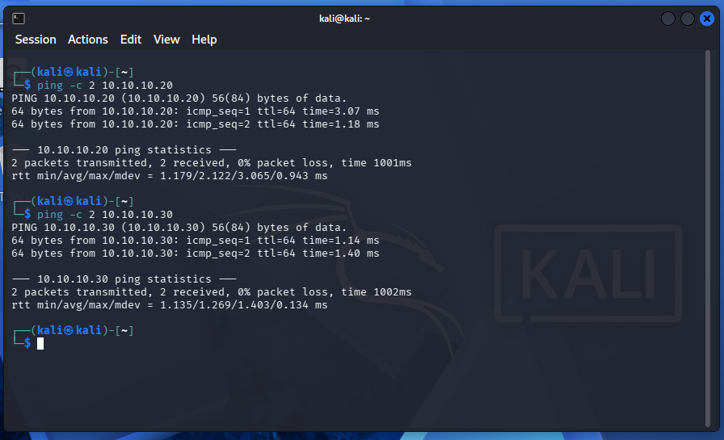
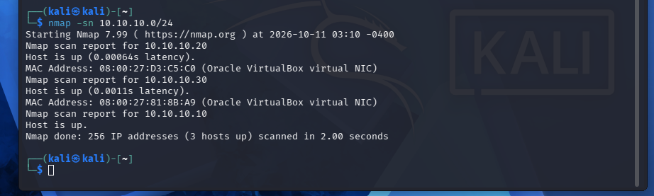
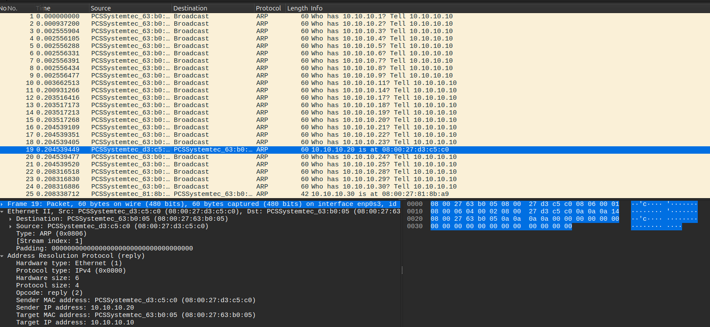

# Lab 02 - Network Discovery and Port Scanning

## Objective

The goal of this lab is to use Nmap to discover active hosts and identify open TCP and UDP ports within the isolated network created in Lab 01.

Wireshark will also be used to capture and analyze the traffic generated during scanning to better understand how host discovery and port scanning work at the packet level.

## Lab Environment

This lab uses the three virtual machines configured in [Lab 01](../01-isolated-lab-environment/).

| System | Role | IP Address |
|---|---|---|
| Kali Linux | Scanning System | 10.10.10.10/24 |
| Metasploitable 2 | Vulnerable Target | 10.10.10.20/24 |
| Ubuntu Observer | Network Monitoring | 10.10.10.30/24 |

All three systems communicate through the VirtualBox Internal Network named `Labnet`, using the `10.10.10.0/24` subnet.

The network remains isolated from the host's normal network and the Internet.

## Methodology

The lab will begin with network validation and host discovery, followed by TCP and UDP port scanning.

Nmap will be used from Kali Linux to scan the lab network and the Metasploitable 2 target. Wireshark will be used on the Ubuntu Observer to capture and examine the network traffic generated during these scans.

Before each scan, I will review the relevant commands and options to understand their purpose and expected results. After running each scan, I will examine the output and captured packets to understand the responses.

Commands, observations, and screenshots will be documented throughout the lab.

## 1. Network Validation

Before beginning the scans, I verified that the three virtual machines retained their network configurations from Lab 01.

On Kali, I checked the IP address and routing table using:

```bash
ip address show dev eth0
ip route
```

On the Ubuntu Observer, I used the same commands with its `enp0s3` network interface:

```bash
ip address show dev enp0s3
ip route
```

On Metasploitable 2, I used:

```bash
ifconfig eth0
route -n
```

All three systems retained their assigned static IP addresses on the `10.10.10.0/24` subnet. Each system had a route to the local network and no default gateway configured.

I then tested connectivity from Kali to Metasploitable 2 and the Ubuntu Observer:

```bash
ping -c 2 10.10.10.20
ping -c 2 10.10.10.30
```

Both systems responded successfully with 0% packet loss.



I also tested connectivity from the Ubuntu Observer to Metasploitable 2:

```bash
ping -c 2 10.10.10.20
```

This test also completed successfully with 0% packet loss.

These results confirmed that all three virtual machines could communicate within the isolated lab network and were ready for scanning.

## 2. Host Discovery

After confirming network connectivity, I used Nmap on Kali Linux to identify active hosts on the `10.10.10.0/24` network.

Before starting the scan, I opened Wireshark on the Ubuntu Observer and began capturing traffic on the `enp0s3` interface.

I then ran the following command from Kali:

```bash
nmap -sn 10.10.10.0/24
```

The `-sn` option tells Nmap to perform host discovery without conducting a port scan. The `10.10.10.0/24` argument specifies the network to scan.

Nmap scanned 256 IP addresses and identified three active hosts:

| IP Address | System | MAC Address |
|---|---|---|
| 10.10.10.10 | Kali Linux | Local scanning system |
| 10.10.10.20 | Metasploitable 2 | 08:00:27:d3:c5:c0 |
| 10.10.10.30 | Ubuntu Observer | 08:00:27:81:8b:a9 |

The scan identified all three virtual machines on the isolated lab network.



### ARP Traffic Analysis

After completing the scan, I examined the captured traffic in Wireshark.

Because the systems were connected to the same local Ethernet network, Nmap used Address Resolution Protocol (ARP) requests to discover active hosts.

The capture showed Kali broadcasting ARP requests across the subnet, asking which devices were associated with specific IP addresses.

For example, Kali sent the following request for Metasploitable 2:

`Who has 10.10.10.20? Tell 10.10.10.10`

Metasploitable responded with its MAC address:

`10.10.10.20 is at 08:00:27:d3:c5:c0`

A similar exchange occurred with the Ubuntu Observer at `10.10.10.30`.



I inspected the Ethernet and ARP headers to examine how the requests and replies were structured.

The ARP requests used the Ethernet broadcast destination `ff:ff:ff:ff:ff:ff`, allowing devices on the local network to receive them.

The replies were sent directly to Kali's MAC address and contained the responding systems' IP and MAC addresses.

The ARP headers distinguished the two message types using their operation codes:

- Request: Opcode 1
- Reply: Opcode 2

I also noticed differences in the ARP traffic between the two systems. Metasploitable 2 received one ARP request and sent one reply, while Ubuntu received six requests and responded to all six.

Metasploitable 2's ARP reply was 60 bytes, including 18 bytes of Ethernet padding. All six Ubuntu replies were 42 bytes, with no padding present in the captured frames.

The captured traffic confirmed how Nmap used ARP responses to identify active systems and obtain their MAC addresses without performing a port scan.

## 3. TCP Port Scanning

Use Nmap to scan the Metasploitable 2 target and identify open TCP ports.

Examine the captured traffic in Wireshark to understand how TCP responses are used to determine whether ports are open, closed, or filtered.

*Documentation and screenshots to be added.*

## 4. UDP Port Scanning

Use Nmap to scan selected UDP ports on the Metasploitable 2 target.

Analyze UDP and ICMP traffic in Wireshark to understand how UDP scanning differs from TCP scanning and why some port states cannot be determined conclusively.

*Documentation and screenshots to be added.*

## 5. Findings

Summarize the discovered hosts, TCP and UDP scan results, and relevant observations from the packet captures.

*Findings to be added.*

## Result

*To be completed after the lab.*

## What I Learned

*To be completed after the lab.*

## References

- [Nmap Reference Guide](https://nmap.org/book/man.html)
- [Nmap Host Discovery](https://nmap.org/book/man-host-discovery.html)
- [Nmap Port Scanning Techniques](https://nmap.org/book/man-port-scanning-techniques.html)
- [Nmap Port Scanning Basics](https://nmap.org/book/man-port-scanning-basics.html)
- [Wireshark Documentation](https://www.wireshark.org/docs/)
