# Lab 03 - Service Enumeration

## Objective

The goal of this lab was to identify the services and software versions running on the open ports discovered in [Lab 02](../02-network-discovery-port-scanning/).

I used Nmap service and version detection to identify the software running on Metasploitable 2. I then examined the captured traffic in Wireshark to understand how Nmap identified those services through banners, protocol requests, and server responses.

I also investigated additional information revealed by certain services, including software versions, registered RPC programs, and information exposed through HTTP responses.

The information collected in this lab will provide a starting point for deeper service enumeration and vulnerability assessment in Lab 04.

## Lab Environment

This lab uses the three virtual machines configured in [Lab 01](../01-isolated-lab-environment/).

| System | Role | IP Address |
|---|---|---|
| Kali Linux | Scanning System | 10.10.10.10/24 |
| Metasploitable 2 | Vulnerable Target | 10.10.10.20/24 |
| Ubuntu Observer | Network Monitoring | 10.10.10.30/24 |

All three systems communicate through the VirtualBox Internal Network named `Labnet`, using the `10.10.10.0/24` subnet.

The network remains isolated from the host's normal network and the Internet.

Nmap was run from Kali Linux, while Wireshark on the Ubuntu Observer captured traffic on the `enp0s3` interface.

## Methodology

I began with the open TCP and UDP ports identified during Lab 02.

First, I used Nmap's `-sV` option to perform service and version detection across the full TCP port range on Metasploitable 2. I then examined the traffic generated by the scan in Wireshark, reviewing all 30 open TCP ports to understand the requests and responses used to identify each service.

For UDP, I began by scanning commonly used ports before examining the locally bound UDP sockets on Metasploitable. This helped identify additional ports for targeted service and version detection without performing a full UDP port scan.

I then compared the remote scanning results with the local socket information and examined the corresponding traffic in Wireshark, reviewing all 11 selected UDP ports.

Although Nmap generated most of the service-detection probes automatically, I manually inspected the captured traffic to understand how the protocols worked and what information their responses revealed.

Rather than documenting every individual exchange, this report includes the overall scan results and focuses on selected examples that demonstrate different service-identification and information-disclosure techniques.

## 1. Service and Version Detection

In Lab 02, I identified 30 open TCP ports on Metasploitable 2. However, the initial port scans primarily identified services based on their common port associations rather than examining the software running behind them.

To identify the actual services and their versions, I used Nmap's service and version detection capabilities.

### TCP Service and Version Detection

I performed a full TCP service/version scan from Kali Linux:

```bash
sudo nmap -sS -sV -p- --open 10.10.10.20
```

The options used were:

- `-sS` - Performs a TCP SYN scan to identify open ports.
- `-sV` - Sends service-detection probes to identify running software and versions.
- `-p-` - Scans all 65,535 TCP ports.
- `--open` - Limits the displayed results to open and potentially open ports.

The scan identified 30 open TCP ports and provided additional information about their associated services.

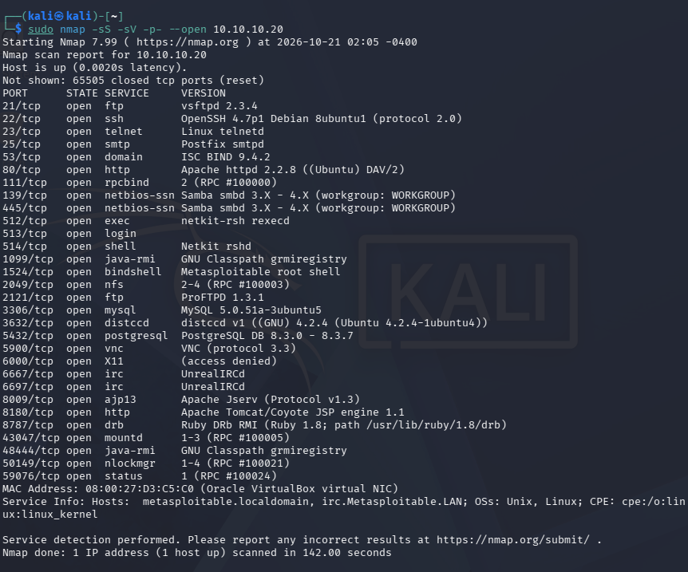

Compared with the port scans performed in Lab 02, the `-sV` scan provided considerably more information about the software accepting connections.

For example, identifying TCP port 21 as open indicates that an FTP service is available. Service detection revealed that the server was running vsftpd 2.3.4.

The scan also identified services on nonstandard ports, such as ProFTPD on TCP 2121, and several RPC services using dynamically assigned ports.

The dynamic TCP ports observed during this scan included:

| Port | Identified Service |
|---|---|
| 43047 | mountd |
| 48444 | Java RMI |
| 50149 | Network Lock Manager |
| 59076 | RPC Status Monitor |

These port assignments can change when Metasploitable restarts or the services are restarted. The values documented here correspond to the scan used for this lab report.

### UDP Service and Version Detection

During Lab 02, I scanned commonly used UDP ports and confirmed that UDP 53 and 137 responded. Other ports, including UDP 69, returned `open|filtered` results.

Rather than performing a full 65,535-port UDP scan, I connected to Metasploitable through SSH from Kali Linux to inspect its locally bound UDP sockets and identify additional ports worth scanning.

Because Metasploitable uses an older SSH server, I needed to enable its legacy RSA host key algorithm for this connection:

```bash
ssh -oHostKeyAlgorithms=+ssh-rsa msfadmin@10.10.10.20
```

After connecting, I ran:

```bash
sudo netstat -ulnp
```

This displayed the locally bound UDP sockets and their associated processes. Using SSH also made it easier to review the complete output than using Metasploitable's limited VirtualBox console.

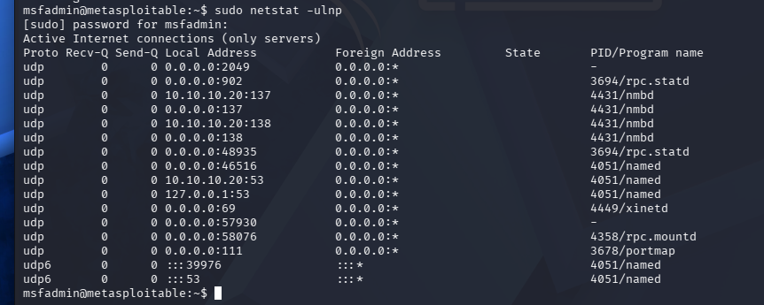

I identified 11 unique IPv4 UDP port numbers from this output.

I then performed a targeted UDP service/version scan from Kali:

```bash
sudo nmap -sU -sV -p 53,69,111,137,138,902,2049,46516,48935,57930,58076 --reason 10.10.10.20
```

The options used were:

- `-sU` - Performs UDP port scanning.
- `-sV` - Attempts to identify services and software versions.
- `-p` - Specifies the selected UDP ports.
- `--reason` - Displays the reason Nmap assigned each port state.

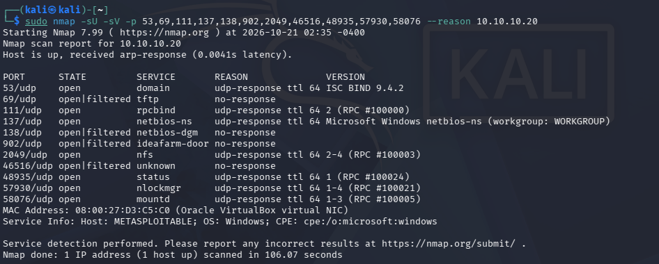

Seven ports were confirmed open through UDP responses, while four were reported as `open|filtered`.

The `open|filtered` classification means Nmap could not determine whether a port was open but not responding to its probes or whether the traffic was being filtered. It does not necessarily mean a firewall was blocking the requests.

The local `netstat` output confirmed that processes or kernel services had sockets bound to these ports, although this alone did not establish how each service would respond to remote requests.

As with TCP, some UDP services used dynamically assigned ports. The additional UDP ports identified through local inspection and Nmap included:

| Port | Local Process / Service |
|---|---|
| 46516 | named (additional UDP socket) |
| 48935 | rpc.statd |
| 57930 | Network Lock Manager |
| 58076 | rpc.mountd |

The local socket inspection also revealed that `rpc.statd` had another UDP socket on port 902. Nmap did not identify this port as an RPC Status Monitor endpoint during the remote scan.

These results demonstrated the importance of comparing remote scanning results with available local system information. Some services responded directly to Nmap's probes, while others required further investigation to understand their behavior.

### Comparing the Scan Results with Wireshark

After completing the TCP and UDP scans, I examined the corresponding packet captures using Wireshark on the Ubuntu Observer.

The captures showed different methods of service identification, including server banners, application-specific requests, and binary protocol responses.

I examined selected examples of these methods in the following section.

## 2. Protocol-Level Service Identification

After identifying the services and software versions running on Metasploitable 2, I examined the captured traffic in Wireshark to understand how Nmap obtained that information.

Different services respond to detection probes in different ways. Some provide identifying information immediately after a connection is established, while others require a specific protocol request before returning useful information.

### FTP - Server Banner Identification

I first examined FTP traffic on TCP port 21 in Wireshark.

I used the display filter `tcp.port == 21` to locate the server's initial response after the TCP connection was established.

Metasploitable returned a `220` greeting identifying its software as `vsFTPd 2.3.4`.

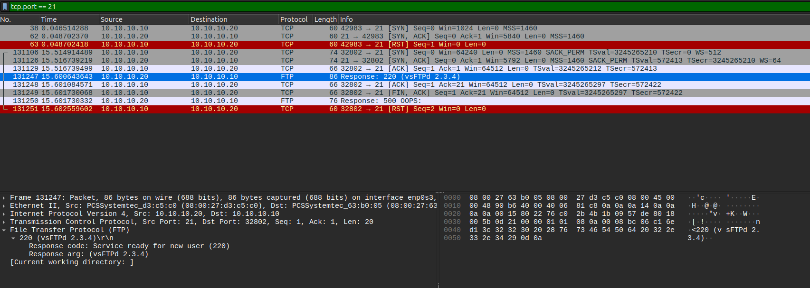

The `220` status code indicates that the FTP service is ready to accept a new user session.

This demonstrated banner-based service identification. The server provided identifying information without requiring Nmap to authenticate or issue additional FTP commands.

Although this information is useful for identifying software, a server banner is not definitive proof of the installed version because banners can be modified or configured to display different information.

### HTTP - Service Identification Through Server Responses

Next, I examined HTTP traffic on TCP port 8180, which Nmap identified as an Apache Tomcat service.

I used the Wireshark display filter `tcp.port == 8180` to inspect the requests and responses.

During service detection, Nmap sent an HTTP request for `/evox/about`.

Metasploitable responded with `404 Not Found`, and the response included an `Apache-Coyote/1.1` server header and an HTML error page identifying Apache Tomcat 5.5.

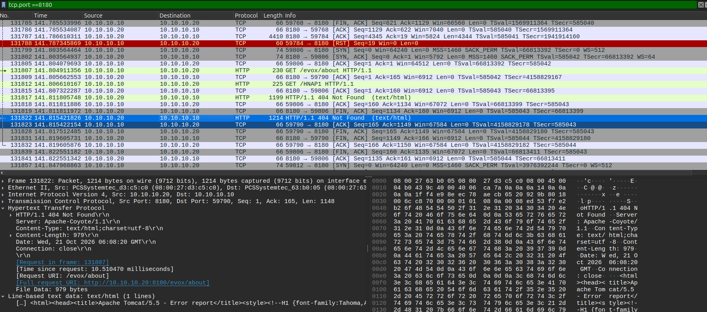

Although the requested resource was not found, the response still provided useful service information.

The `404 Not Found` status indicated that the requested path was unavailable, not that the HTTP service itself was unreachable.

This demonstrated how Nmap could obtain service information by sending application-layer requests and examining the responses, even when the requested resource did not exist.

### Java RMI - Binary Protocol Identification

I also examined TCP port 1099, which Nmap identified as a Java Remote Method Invocation (RMI) registry.

Unlike FTP and HTTP, Java RMI uses a binary protocol rather than human-readable text messages for its initial communication.

I used the Wireshark display filter `tcp.port == 1099` to examine the requests and responses.

The packet capture showed Nmap sending a JRMI handshake using protocol version 2 and the `StreamProtocol` transport.

Metasploitable responded with a `ProtocolAck` message, indicating that it recognized the JRMI protocol.

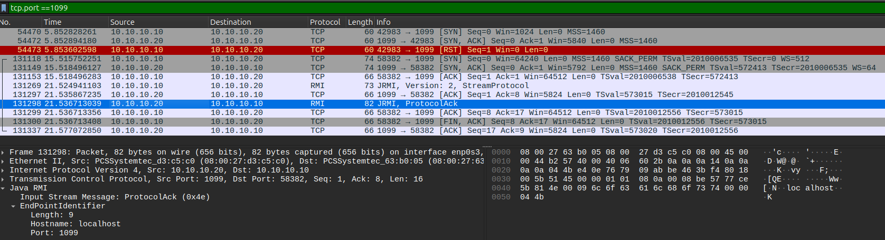

The version number shown in Wireshark referred to the JRMI protocol, not the installed Java software version.

This demonstrated how Nmap can identify a service through a binary protocol exchange rather than relying on readable banners or HTTP headers.

These examples showed how Nmap identified services through different types of communication, including server greetings, HTTP responses, and binary protocol handshakes.

However, identifying a service does not necessarily reveal all the information it makes available. I investigated several examples of additional information disclosure in the next section.

## 3. Service Information Enumeration

After examining how Nmap identified different services, I investigated additional information revealed by their responses.

Depending on the protocol and configuration, service responses can disclose application details, available resources, registered services, and other information useful for understanding the target.

### HTTP - Web Server Information Disclosure

I examined HTTP traffic on TCP port 80 using the Wireshark display filter `tcp.port == 80`.

I selected an HTTP exchange and used Wireshark's Follow TCP Stream feature to examine the complete request and response.

Metasploitable responded to a request for the root page with `200 OK`. The response headers disclosed Apache 2.2.8 on Ubuntu with DAV support, along with PHP version `5.2.4-2ubuntu5.10`.

The response also contained the default Metasploitable web page.

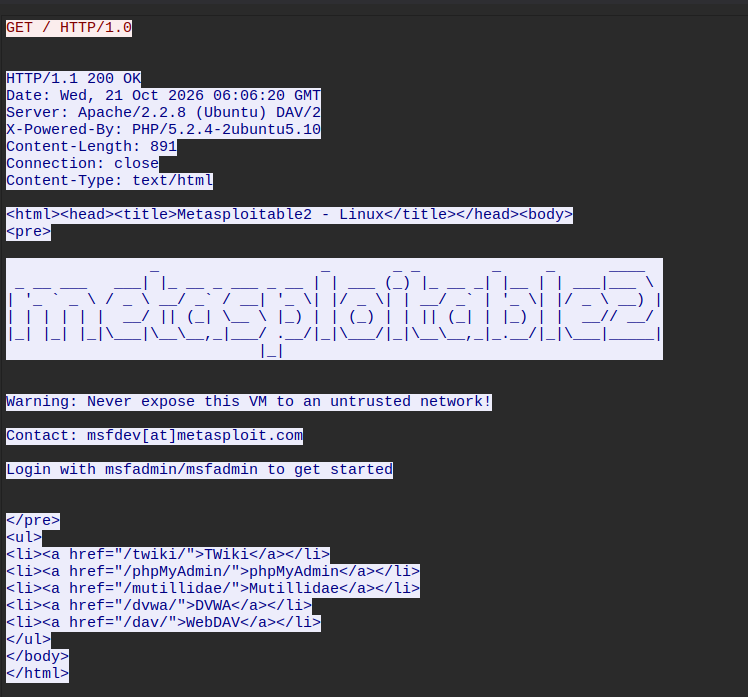

The page identified several available web applications and directories, including TWiki, phpMyAdmin, Mutillidae, DVWA, and WebDAV.

Additionally, the page displayed the default credentials `msfadmin/msfadmin`, exposing login information directly through the web server without requiring authentication.

During additional testing, I confirmed that these credentials also worked for FTP authentication on the target. I did not perform deeper authentication enumeration or exploitation as part of this lab.

This demonstrated that HTTP responses can reveal more than the identity of the web server. Headers and page content may disclose software versions, application entry points, and authentication information.

These findings provide possible starting points for targeted investigation during the vulnerability assessment in Lab 04.

### DNS - Version Information Disclosure

Next, I examined DNS traffic on UDP port 53.

I used the Wireshark display filter `udp.port == 53` to examine the queries and responses.

The packet capture showed a DNS TXT record query for `version.bind` using the CHAOS (`CH`) DNS class.

Metasploitable's DNS server returned the version string `9.4.2`, matching the ISC BIND version identified by Nmap.

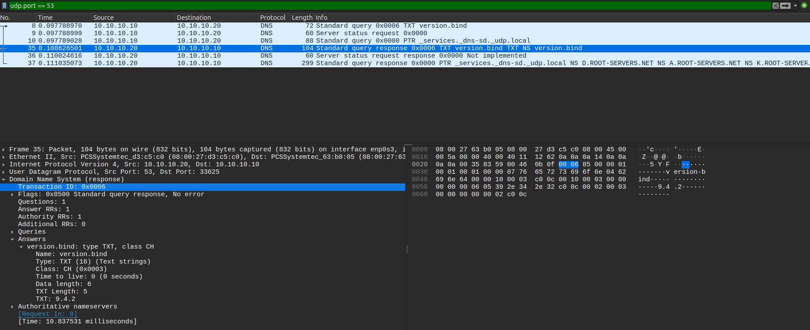

Unlike a normal DNS query used to resolve a domain name to an IP address, this request asked the DNS server for information about its software version.

The `version.bind` query demonstrated how a service can disclose implementation details through a protocol-specific request.

Although the response provided useful information about the DNS server, the reported version alone did not establish whether the service was vulnerable.

### RPC - Registered Service Enumeration

I also examined traffic associated with RPCbind on UDP port 111.

RPCbind maintains a mapping of registered Remote Procedure Call (RPC) programs to the ports and transport protocols they use. This is useful because some RPC services do not operate on fixed port numbers.

I used the Wireshark display filter `udp.port == 111` to examine the requests and responses.

The capture showed a Portmap Version 2 `DUMP` request from Kali, followed by a response from Metasploitable.

The response contained registrations for several RPC programs, including NFS, MOUNT, Network Lock Manager, and RPC Status Monitor.

For example, the captured MOUNT version 1 registration identified TCP port 43047 and UDP port 58076.

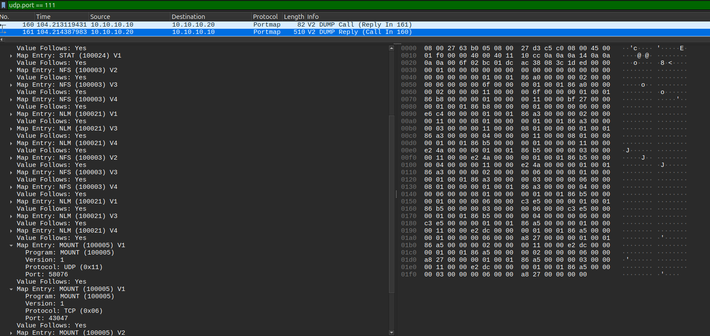

These values matched the `mountd` ports identified during the TCP and UDP service scans.

This demonstrated how RPCbind can reveal services that use dynamically assigned ports. Rather than relying only on common port numbers, a scanner can query RPCbind to identify registered RPC programs and their current network endpoints.

The registrations also included program versions and transport information, providing additional details about the target's available RPC services.

However, identifying a registered RPC service did not establish what files or resources were accessible through that service. Further enumeration would be required to determine that.

### TFTP - Read Requests and Dynamic Response Ports

Finally, I investigated TFTP on UDP port 69.

The targeted UDP scan classified this port as `open|filtered`, meaning Nmap did not obtain enough information to confirm its state. However, the Wireshark capture contained TFTP traffic that provided additional information about the service's behavior.

I used the Wireshark display filter `udp.port == 69` to locate the initial requests.

In frame 58, Kali sent a TFTP Read Request (RRQ) from UDP port 59503 to Metasploitable on UDP port 69.

The request attempted to retrieve `r7tftp.txt` using octet mode, which transfers file contents as raw bytes.

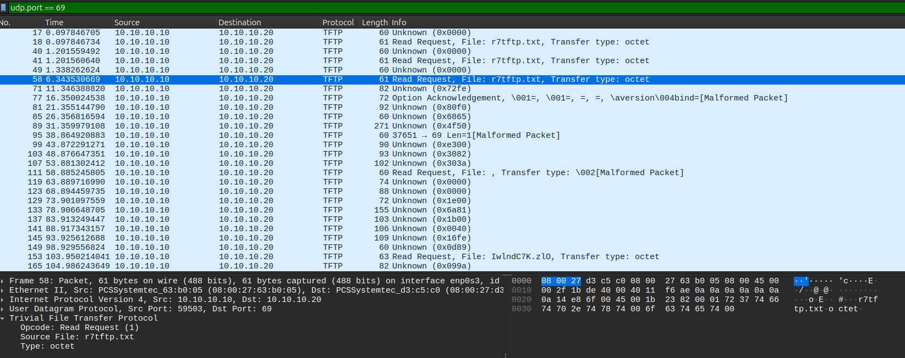

I then examined the TFTP error responses using:

```wireshark
tftp.opcode == 5 && ip.src == 10.10.10.20
```

In frame 69, Metasploitable responded to the request from frame 58 with the error message `No such file or directory`.

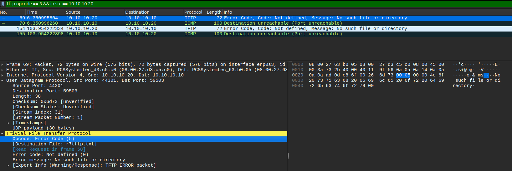

An important detail was that the response came from UDP port 44301 rather than port 69 and was sent back to Kali's original source port, 59503.

TFTP uses port 69 to receive initial requests, but the server can use a separate UDP port for the subsequent exchange. This explains why examining only traffic with `udp.port == 69` would not show every packet associated with the request.

The capture also showed Kali sending an ICMP Port Unreachable message after receiving the TFTP error response.

Despite the response observed in Wireshark, Nmap reported UDP 69 as `open|filtered`. The capture did not establish exactly why Nmap retained that classification.

This demonstrated how packet analysis can reveal protocol behavior that is not apparent from a port scan's final summary.

By combining Nmap results with Wireshark analysis, I was able to identify not only which services were running but also what additional information their responses exposed.

These findings provide a foundation for selecting services to investigate more deeply during Lab 04.

## 4. Findings

The service enumeration identified a variety of network services running on Metasploitable 2 and revealed additional information about their software, configuration, and communication protocols.

The main findings were:

- **Service and version identification:** Nmap identified 30 open TCP ports and returned seven `open` and four `open|filtered` results from the targeted UDP scan. Several services disclosed software versions, including vsftpd 2.3.4, Apache 2.2.8, and ISC BIND 9.4.2.

- **Multiple services using similar protocols:** The target exposed two different FTP servers on TCP ports 21 and 2121, along with HTTP services on ports 80 and 8180. This demonstrated why service detection is useful beyond identifying common port numbers.

- **Information disclosure through service responses:** The HTTP server revealed Apache and PHP versions, available web applications, and default credentials. I also confirmed that the disclosed `msfadmin/msfadmin` credentials worked for FTP authentication. The DNS server returned its BIND version through a `version.bind` query.

- **RPC service registrations:** RPCbind revealed registered RPC programs, their versions, transport protocols, and dynamically assigned ports. These registrations helped explain the additional RPC-related ports identified during the TCP and UDP scans.

- **Different service identification methods:** Wireshark showed that Nmap identified services through FTP banners, HTTP responses, and binary protocol exchanges such as the Java RMI handshake.

- **UDP scan limitations:** Several UDP ports remained `open|filtered` despite having locally bound sockets. TFTP traffic also showed that a service could respond from a different UDP port than the one receiving its initial request.

These findings demonstrated that identifying an open port is only the beginning of service enumeration. Understanding the software running behind the port, the information it exposes, and how its protocol operates provides a more complete picture of the target.

Although several findings may warrant security investigation, the presence of an older software version or an exposed service does not automatically establish a confirmed vulnerability. Those questions will be examined during Lab 04.

## Result

I successfully completed the service enumeration of Metasploitable 2 using Nmap and Wireshark.

By examining both TCP and UDP traffic, I was able to identify running services, investigate their communication protocols, and document information exposed through their responses.

The collected information provides a starting point for deeper enumeration and vulnerability assessment in Lab 04.

## What I Learned

This lab helped me better understand how Nmap identifies the services running on open ports and how examining network traffic can reveal information beyond the results of a port scan.

Reviewing the service detection traffic in Wireshark showed me that different protocols reveal their identities in different ways. FTP provided a readable server banner, while HTTP responses contained identifying information in headers and error pages. Examining Java RMI also showed me how Nmap can identify a service through a binary protocol handshake without relying on readable text.

I gained a better understanding of UDP enumeration by comparing Nmap's results with the sockets listening on Metasploitable. Some ports responded to detection probes, while others remained `open|filtered`. Investigating TFTP also helped me understand why a UDP service might receive an initial request on one port but send its response from another.

RPC was another area I became more familiar with during this lab. Examining RPCbind responses helped me understand how RPC programs are registered and how services can use dynamically assigned ports instead of fixed port numbers.

Finally, examining HTTP and DNS responses showed me how services can expose software versions, available applications, and other information that may be useful during security assessments. I learned that identifying a service is only the first step, and understanding what information it exposes is important when deciding what to investigate further.

## References

- [Nmap Service and Version Detection](https://nmap.org/book/man-version-detection.html)
- [Nmap UDP Scanning](https://nmap.org/book/scan-methods-udp-scan.html)
- [Wireshark User's Guide](https://www.wireshark.org/docs/wsug_html/)
- [Wireshark - Following Protocol Streams](https://www.wireshark.org/docs/wsug_html_chunked/ChAdvFollowStreamSection.html)
- [Oracle - Java Remote Method Invocation (RMI)](https://docs.oracle.com/javase/8/docs/technotes/guides/rmi/)
- [Oracle - Java RMI Wire Protocol](https://docs.oracle.com/javase/8/docs/platform/rmi/spec/rmi-protocol3.html)
- [ISC - BIND Server Version Queries](https://kb.isc.org/docs/aa-00307)
- [RFC 1833 - RPCbind and Port Mapper Protocols](https://www.rfc-editor.org/info/rfc1833/)
- [RFC 1350 - Trivial File Transfer Protocol (TFTP)](https://www.rfc-editor.org/info/rfc1350/)
- [OpenSSH - Legacy Options](https://www.openssh.org/legacy.html)
- [Linux netstat(8) Manual](https://man7.org/linux/man-pages/man8/netstat.8.html)
