# Lab 04 - Vulnerability Assessment


## Objective

The goal of this lab was to perform deeper enumeration and vulnerability assessment on selected services running on Metasploitable 2.

Some targets were chosen based on findings investigated in [Lab 03](../03-service-enumeration/), while others were selected from the broader service scan results to examine a wider variety of vulnerabilities and security weaknesses.

I investigated five targets: vsftpd, Samba, distccd, DVWA, and NFS. These assessments covered different security issues, including backdoors, command injection, insecure service configurations, SQL injection, and exposed file shares.

I researched known vulnerabilities, performed targeted security checks, and examined service configurations and application source code to identify potential weaknesses. I also used Wireshark to analyze relevant network traffic.

The purpose was to document the findings, distinguish potential vulnerabilities from confirmed weaknesses, and identify suitable candidates for controlled exploitation in [Lab 05](../05-controlled-exploitation/).

## Lab Environment

This lab used the same isolated VirtualBox environment established in [Lab 01](../01-isolated-lab-environment/).

The environment consisted of three virtual machines:

| Virtual Machine | IP Address | Role |
|---|---|---|
| Kali Linux | `10.10.10.10` | Attacker system used for vulnerability research, enumeration, and security testing. |
| Metasploitable 2 | `10.10.10.20` | Intentionally vulnerable target hosting the services being assessed. |
| Ubuntu | `10.10.10.30` | Network monitoring system running Wireshark to capture and analyze traffic. |

All three virtual machines communicated through the VirtualBox Internal Network named `Labnet`, isolated from the host's home network and the Internet.

## Methodology

I began by reviewing the service enumeration results from [Lab 03](../03-service-enumeration/) and selecting targets that would allow me to investigate different types of vulnerabilities.

For services with known vulnerabilities, I used SearchSploit to identify relevant exploit references and examine their source code. I also consulted vulnerability information and documentation to understand how the weaknesses worked and what conditions were required for exploitation.

I then performed targeted remote enumeration using Nmap, NSE scripts, and service-specific tools where appropriate. I evaluated the purpose of each check before running it, avoiding scripts that would actively exploit the vulnerabilities being investigated.

Where useful, I used Wireshark on the Ubuntu observer to examine network traffic generated by these checks and understand how relevant information was exchanged between Kali and Metasploitable 2.

I also connected directly to Metasploitable 2 to inspect service configurations and application source code. These checks helped verify weaknesses that could not be fully established through remote enumeration alone.

Finally, I evaluated the collected evidence to distinguish potential vulnerabilities from confirmed insecure configurations or vulnerable code.

No vulnerabilities were actively exploited during this lab. The findings will guide controlled exploitation testing in [Lab 05](../05-controlled-exploitation/).

## 1. FTP - vsftpd Backdoor Assessment

### Vulnerability Research

During [Lab 03](../03-service-enumeration/), Nmap identified vsftpd 2.3.4 running on TCP port 21 of Metasploitable 2.

I used SearchSploit to research known vulnerabilities associated with this version:

```bash
searchsploit vsftpd 2.3.4
```

SearchSploit returned two exploit references associated with CVE-2011-2523, a backdoor found in a compromised distribution of vsftpd 2.3.4.

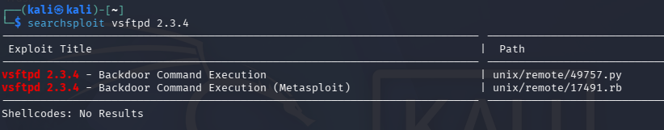

This vulnerability was introduced through a maliciously modified software distribution rather than a normal programming error. As a result, identifying vsftpd 2.3.4 does not automatically confirm that the installed copy contains the backdoor.

### Backdoor Mechanism

To understand how the backdoor worked, I examined the Python exploit source using SearchSploit:

```bash
searchsploit -x 49757
```

The exploit contained the following relevant code:

```python
portFTP = 21

user="USER nergal:)"
password="PASS pass"

tn=Telnet(host, portFTP)
tn.read_until(b"(vsFTPd 2.3.4)")
tn.write(user.encode('ascii') + b"\n")
tn.read_until(b"password.")
tn.write(password.encode('ascii') + b"\n")

tn2=Telnet(host, 6200)
print('Success, shell opened')
print('Send `exit` to quit shell')
tn2.interact()
```

The script first connects to the FTP service on TCP port 21 using Python's `Telnet` class and waits for the server's banner.

It then sends `USER nergal:)`. The username contains the characters `:)`, which are recognized by the malicious code in compromised installations of vsftpd 2.3.4.

The script waits for the server's password prompt and sends `PASS pass` to continue the FTP interaction. The password is not responsible for triggering the backdoor; the specially crafted username is the important part.

If the backdoor is present and successfully triggered, the server opens a command shell on TCP port 6200.

The script then attempts a second connection using `Telnet(host, 6200)`. If successful, `tn2.interact()` provides an interactive session with the remote shell.

### Remote Assessment

After examining the exploit, I performed a targeted TCP SYN scan to check the FTP service and the port associated with the backdoor:

```bash
sudo nmap -sS -p 21,6200 --reason 10.10.10.20
```

The `-sS` option performs a TCP SYN scan, `-p` specifies the ports to check, and `--reason` displays why Nmap classified each port as open or closed.

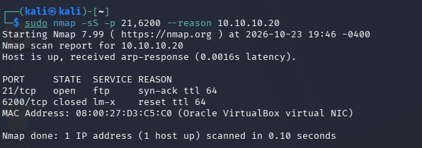

The scan confirmed that FTP was accessible on port 21, while port 6200 was closed. However, a closed port does not rule out the vulnerability because the backdoor listener is designed to activate only after receiving the triggering username.

I also performed additional FTP enumeration using two Nmap NSE scripts:

```bash
sudo nmap -sV -p 21 --script ftp-syst,ftp-anon 10.10.10.20
```

The `ftp-syst` script requests FTP system and status information using the `SYST` and `STAT` commands, while `ftp-anon` checks whether anonymous login is permitted.

The scan returned server status information and confirmed anonymous FTP access, which had already been observed during [Lab 03](../03-service-enumeration/). These checks provided additional information about the service but did not establish whether the backdoor was present.

Nmap also provides an `ftp-vsftpd-backdoor` script designed to test CVE-2011-2523. However, this script attempts to trigger the backdoor and potentially execute commands on the target. I excluded it from this assessment because active exploitation was reserved for [Lab 05](../05-controlled-exploitation/).

### Assessment Result

The assessment identified vsftpd 2.3.4 as a potential target for CVE-2011-2523, a backdoor vulnerability capable of providing remote command execution.

Examining the Python exploit revealed how the specially crafted FTP username could activate a shell on TCP port 6200. The remote checks confirmed that the FTP service was accessible, but did not establish whether the backdoor was present.

Although the installed version matches the affected release, the presence of the backdoor remains unconfirmed. Further testing during [Lab 05](../05-controlled-exploitation/) will determine whether the backdoor can be activated in the isolated environment.

## 2. Samba - Command Injection Assessment

### Vulnerability Research

During [Lab 03](../03-service-enumeration/), Nmap identified Samba services on TCP ports 139 and 445 but did not confirm an exact software version.

To verify the installed version, I checked Samba directly on Metasploitable 2:

```bash
smbd -V
```

The command confirmed that Samba 3.0.20-Debian was installed.

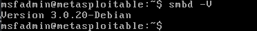

I then used SearchSploit to research known vulnerabilities associated with this version:

```bash
searchsploit samba 3.0.20
```

The results included an exploit associated with CVE-2007-2447, a remote command execution vulnerability affecting Samba versions 3.0.0 through 3.0.25rc3 when the non-default `username map script` configuration option is enabled.

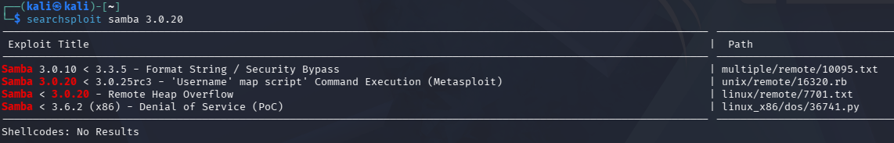

To understand how the vulnerability could be exploited, I examined the corresponding Metasploit module written in Ruby:

```bash
searchsploit -x 16320
```

The exploit contained the following relevant code:

```ruby
connect
username = "/=`nohup " + payload.encoded + "`"

simple.client.negotiate(false)
simple.client.session_setup_ntlmv1(username, rand_text(16), datastore['SMBDomain'], false)
```

The script establishes a connection to Samba and constructs a malicious username containing shell command substitution syntax. In Unix shells, commands enclosed in backticks can be executed, with their output substituted into the surrounding command.

The `payload.encoded` value represents the command supplied by Metasploit, while `nohup` is used to prevent the command from being terminated by a hangup signal.

The script then negotiates an SMB connection and submits the crafted username during SMB session setup. The `rand_text(16)` argument supplies a random password value, but valid credentials are not required because the vulnerable username mapping operation occurs before authentication.

The vulnerability occurs when Samba passes the attacker-controlled username to an external mapping script through a shell without properly handling special characters. This can cause the embedded command to execute on the server.

Unlike the vsftpd backdoor, this vulnerability results from improper handling of untrusted input rather than deliberately inserted malicious code.

Although the identified Samba version falls within the affected range, exploitation also requires the `username map script` functionality to be enabled. Further remote investigation and configuration verification were needed to establish whether the target met these conditions.

### Remote Assessment

After researching CVE-2007-2447, I used `smbclient` to investigate how usernames are transmitted to Samba during SMB session setup.

From Kali, I sent a normal authentication attempt using the test username `labprobe`:

```bash
smbclient -L 10.10.10.20 -p 139 -U labprobe -m NT1 --option='client min protocol=NT1'
```

The `-L` option requests a list of available SMB shares, `-p 139` specifies the connection port, and `-U` supplies the test username. The `-m NT1` and `client min protocol=NT1` options allow communication using the older SMB1 protocol supported by Metasploitable.

The server returned `NT_STATUS_LOGON_FAILURE` because the supplied credentials were invalid. However, successful authentication was not necessary to observe how the username was transmitted.

I examined the corresponding network traffic using Wireshark on the Ubuntu observer.

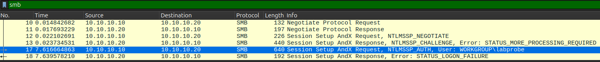

The capture showed Kali sending an SMB Session Setup request containing an `NTLMSSP_AUTH` message with the username `WORKGROUP\labprobe`. Metasploitable then responded with an authentication failure.

This demonstrated how client-supplied usernames are transmitted through SMB session setup, the same general input mechanism used by the Ruby exploit examined earlier.

Although the experiment confirmed the username was transmitted to Samba, it did not establish whether the server processed it through the vulnerable mapping functionality. This required further configuration verification.

### Configuration Verification

After examining the SMB authentication traffic, I connected directly to Metasploitable 2 to check whether the `username map script` functionality required for CVE-2007-2447 was enabled.

I used `testparm` to inspect Samba's configuration:

```bash
testparm -sv 2>/dev/null | grep -i 'username map script'
```

The `-sv` options display Samba's configuration settings, including default values. The `grep -i` command filters the output for `username map script`, while `2>/dev/null` suppresses diagnostic messages.

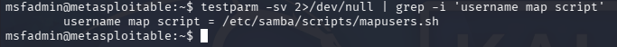

This confirmed that Samba had an external username mapping script configured, satisfying an important prerequisite for CVE-2007-2447.

Combined with the affected Samba version identified earlier, this provided strong evidence that the target could be vulnerable to command injection.

### Assessment Result

The assessment identified an affected Samba version and confirmed that the non-default `username map script` functionality required for CVE-2007-2447 was enabled.

The remote investigation also demonstrated how client-supplied usernames are transmitted through SMB session setup, the input mechanism targeted by the exploit.

Together, these findings provide strong evidence that the conditions for command injection are present. [Lab 05](../05-controlled-exploitation/) will focus on determining whether a specially crafted username can successfully execute commands on the target.

## 3. distccd - Remote Command Execution Assessment

### Vulnerability Research

During [Lab 03](../03-service-enumeration/), Nmap identified distccd running on TCP port 3632 of Metasploitable 2.

Distccd is the server component of distcc, a distributed compilation system that allows computers to send compilation jobs to other machines for processing.

I used SearchSploit to research known vulnerabilities associated with this service:

```bash
searchsploit distcc
```

The results included a Metasploit exploit associated with CVE-2004-2687, a remote command execution vulnerability involving distccd servers that accept compilation requests from untrusted clients.

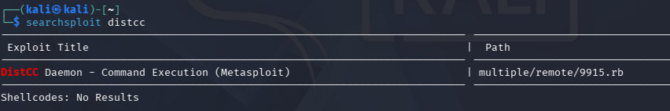

To understand how the vulnerability could be exploited, I examined the corresponding Ruby module:

```bash
searchsploit -x 9915
```

The exploit contained the following relevant code:

```ruby
distcmd = dist_cmd("sh", "-c", payload.encoded);
sock.put(distcmd)
```

The `dist_cmd` function constructs a request using the distcc protocol, with fields such as `DIST`, `ARGC`, and `ARGV` to format the command and its arguments. Instead of requesting a normal compilation using GCC, the exploit supplies `sh` and `-c`, instructing a shell to execute the command contained in `payload.encoded`.

The `sock.put(distcmd)` call sends the constructed request to the remote distccd service.

If the server accepts and processes the request, the supplied command may execute with the privileges of the distccd process.

Unlike the vsftpd backdoor, this weakness does not require deliberately modified software. It arises from allowing untrusted clients to submit compilation jobs without adequate restrictions.

Further investigation was needed to determine whether Metasploitable's distccd service was configured to accept requests from untrusted clients.

### Service Configuration Verification

After examining the exploit, I connected directly to Metasploitable 2 to investigate how distccd was running and whether it restricted remote clients.

I examined the running processes using:

```bash
ps -ef | grep '[d]istccd'
```

The `ps -ef` command lists running processes, while `grep` filters the results for distccd.

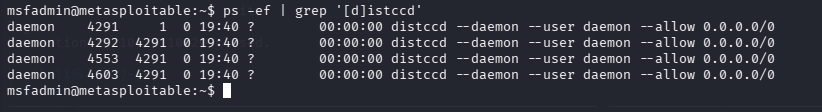

The running processes showed that distccd was configured with `--allow 0.0.0.0/0`, permitting connections from any IPv4 address that could reach the service.

The `--user daemon` option also showed that the service was running under the `daemon` account rather than root. Commands executed through the service would therefore normally inherit that account's permissions.

This configuration is significant because distccd accepts compilation requests that can result in command execution. Allowing unrestricted client addresses exposes that functionality to untrusted systems.

### Assessment Result

The assessment identified a remotely accessible distccd service with unrestricted client access, creating a potential remote command execution vulnerability associated with CVE-2004-2687.

The exploit analysis demonstrated how a crafted compilation request could cause distccd to execute arbitrary commands, while the process configuration confirmed that the service permitted connections from any IPv4 address.

These findings provided strong evidence of the security exposure. [Lab 05](../05-controlled-exploitation/) will test whether commands can be executed remotely and determine the level of access obtained.

## 4. DVWA - SQL Injection Assessment

### Vulnerability Research

During [Lab 03](../03-service-enumeration/), I identified Damn Vulnerable Web Application (DVWA) running on the Apache web server hosted by Metasploitable 2.

Rather than investigating another service-level vulnerability, I selected DVWA to examine SQL injection, a vulnerability affecting how web applications interact with databases.

SQL injection occurs when an application incorporates untrusted user input into an SQL query without properly separating the input from the query's instructions. An attacker may be able to manipulate the resulting query to retrieve unauthorized information, bypass application restrictions, or modify database contents.

I initially searched for relevant exploit references using SearchSploit:

```bash
searchsploit dvwa
```

The search did not provide useful exploit references for this assessment, so I instead examined DVWA's own PHP source code to understand how the SQL injection vulnerability worked.

I also examined Nmap's SQL injection detection script:

```bash
nmap --script-help http-sql-injection
```

The script was classified as intrusive because it sends crafted requests to test for SQL injection. I chose not to run it during this assessment, reserving active injection testing for [Lab 05](../05-controlled-exploitation/).

Instead, I planned to submit a normal request to DVWA's SQL Injection page, inspect the resulting HTTP traffic, and examine the application's PHP source code to determine how the input was processed.

### Web Application Assessment

I accessed DVWA through the Apache web server on Metasploitable 2 using a browser on Kali and logged in with the default credentials (`admin` / `password`).

I set DVWA's security level to Low and navigated to the SQL Injection page. This setting was selected to examine the application's intentionally vulnerable behavior without additional security protections.

I submitted the user ID `1` through the application's input field. The page returned the corresponding user's information, demonstrating how the application retrieved records from its database based on the supplied ID.

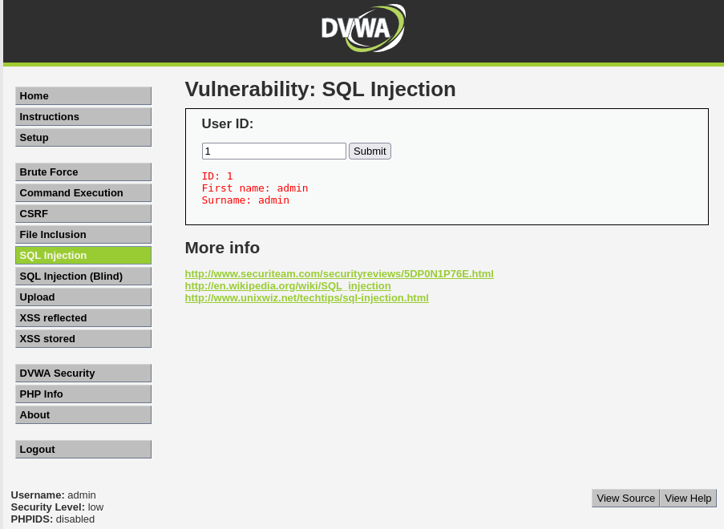

I then examined the HTTP traffic using Wireshark on the Ubuntu observer.

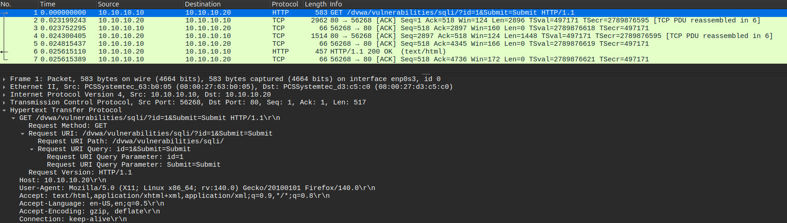

The capture showed a GET request containing the submitted value in the URL:

```http
GET /dvwa/vulnerabilities/sqli/?id=1&Submit=Submit HTTP/1.1
```

The `id=1` parameter carried the user-supplied value, while `Submit=Submit` represented the form submission. Because the request used HTTP rather than HTTPS, these parameters were visible in the captured network traffic.

This confirmed how the user's input was transmitted from the browser to the web application. However, observing the request alone did not reveal how DVWA handled the value when constructing its database query.

To investigate that behavior, I examined the application's PHP source code directly on Metasploitable 2.

### Source Code Verification

After examining the HTTP request, I connected directly to Metasploitable 2 to investigate how DVWA processed the submitted user ID.

I examined the PHP source file responsible for handling SQL Injection requests at the Low security level:

```text
/var/www/dvwa/vulnerabilities/sqli/source/low.php
```

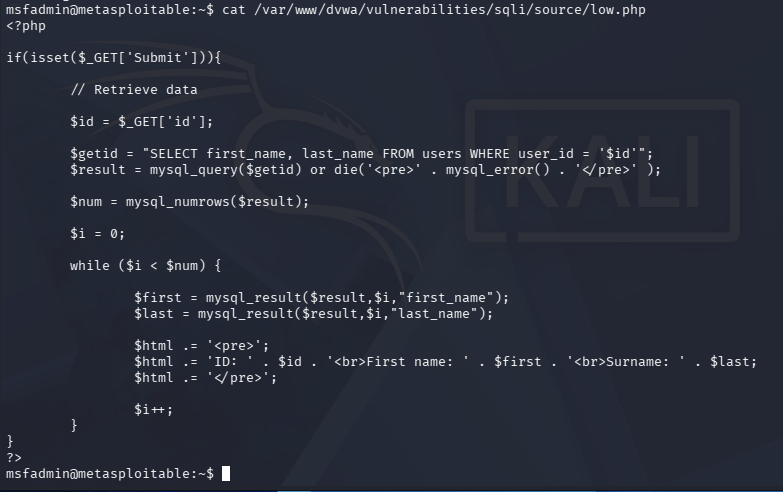

The source code showed that the application retrieved the submitted ID using `$_GET['id']`, which reads the value of the `id` parameter from the HTTP request.

The application then constructed an SQL query by inserting that value directly into the statement:

```php
$getid = "SELECT first_name, last_name FROM users WHERE user_id = '$id'";
```

The query selects the first and last names of users whose `user_id` matches the submitted value. However, because `$id` is inserted directly into the SQL statement without parameterization, specially crafted input could alter the intended query structure. Parameterized queries prevent this by keeping user-supplied values separate from the SQL instructions.

The application then passed the constructed query to `mysql_query()` for execution against the database.

This confirmed that DVWA's Low security implementation contained an SQL injection vulnerability. Unlike the previous service assessments, the vulnerable behavior could be established directly from the application's source code without submitting a malicious request.

Active SQL injection testing was reserved for [Lab 05](../05-controlled-exploitation/).

### Assessment Result

The assessment confirmed an SQL injection vulnerability in DVWA's Low security implementation.

The application accepted a user-supplied ID through an HTTP GET request, and source code inspection revealed that the value was inserted directly into an SQL query without parameterization.

These findings established that the application contained vulnerable query construction. [Lab 05](../05-controlled-exploitation/) will test how specially crafted input can manipulate the query and determine what database information can be accessed.

## 5. NFS - Export Misconfiguration Assessment

### Remote Export Enumeration

During [Lab 03](../03-service-enumeration/), Nmap identified RPC services on TCP port 111 and NFS on TCP port 2049 of Metasploitable 2.

Network File System (NFS) allows computers to access files and directories shared by another system over a network. The directories made available through NFS are called exports, and the server's export configuration determines which clients are permitted to access them.

I investigated whether Metasploitable exposed any NFS exports and whether their access restrictions presented a security risk.

From Kali, I used Nmap's `nfs-showmount` script to enumerate the server's exports:

```bash
sudo nmap -sV -p 111 --script nfs-showmount 10.10.10.20
```

The `-p 111` option targets the RPC binding service, which allows clients to discover the ports used by registered RPC programs. The `nfs-showmount` script uses this information to communicate with the NFS mount service and retrieve the list of exported directories and their permitted clients.

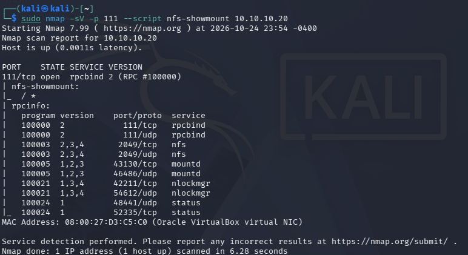

The results showed that the server exported its root directory (`/`) to all clients (`*`), rather than restricting access to specific addresses or networks.

Exporting the root filesystem without limiting eligible clients presents a significant security concern, potentially exposing sensitive files and directories to systems that can reach the NFS service.

However, the remote enumeration did not establish the export's read/write permissions or whether additional restrictions, such as root squashing, were enabled. These settings required further configuration verification.

### Network Traffic Analysis

While performing the NFS export enumeration, I captured the related network traffic using Wireshark on the Ubuntu observer.

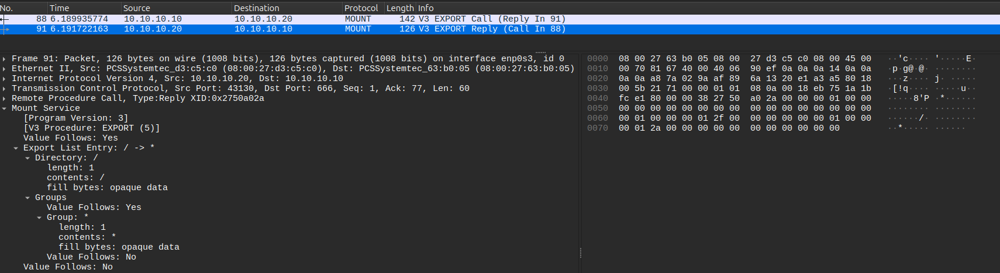

The capture showed Kali sending an RPC MOUNT version 3 `EXPORT` request to Metasploitable 2. This request asks the server's mount service (`mountd`) for a list of exported directories and the clients permitted to access them.

Unlike the NFS service on TCP port 2049, `mountd` was using the dynamically assigned TCP port 43130, which could be discovered through the RPC binding service on port 111.

Metasploitable responded with an `EXPORT` reply containing the exported root directory (`/`) and its client access group (`*`), matching the results obtained through Nmap.

This demonstrated how the `nfs-showmount` script retrieved information about the server's shared directories through RPC. The request only enumerated the available exports; it did not mount the filesystem or access its contents.

### Configuration Verification

After examining the NFS traffic, I connected directly to Metasploitable 2 to verify the server's export configuration and determine what access permissions were enabled.

I examined the active NFS exports using:

```bash
sudo exportfs -v
```

The `-v` option displays the exported directories along with their configured access options.

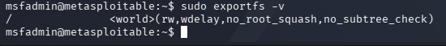

The configuration confirmed that the root filesystem (`/`) was exported to all clients with `rw` and `no_root_squash` enabled.

The `rw` option permits clients to perform both read and write operations, subject to filesystem permissions. Normally, NFS uses root squashing to map requests from a client's root account to an unprivileged identity on the server. The `no_root_squash` option disables this protection, allowing requests from the client's root account to retain root privileges on the exported filesystem.

Together, these settings create a significant security risk. A client able to mount the export could potentially access or modify sensitive files on the server, including files normally restricted to root.

### Assessment Result

The assessment confirmed that Metasploitable 2 exposed its root filesystem through NFS without restricting access to specific clients.

Remote enumeration identified the unrestricted export, while server-side configuration verification established that read/write access and `no_root_squash` were enabled.

These findings confirmed a significant NFS security misconfiguration that could allow unauthorized access to sensitive files and potentially enable modifications with root-level privileges.

[Lab 05](../05-controlled-exploitation/) will test whether Kali can mount the exported filesystem and determine what level of file access the configuration permits.

## 6. Findings

The five assessments identified several potential and confirmed security weaknesses affecting Metasploitable 2. The findings are summarized below.

| Target | Vulnerability | Key Findings | Assessment Status |
|---|---|---|---|
| vsftpd 2.3.4 | Backdoor (CVE-2011-2523) | Identified an affected software version and examined the backdoor mechanism. | Potential vulnerability; backdoor not confirmed |
| Samba 3.0.20 | Command Injection (CVE-2007-2447) | Confirmed that the affected Samba version had `username map script` configured. | Strong evidence of vulnerability; execution not tested |
| distccd | Remote Command Execution (CVE-2004-2687) | Confirmed that the service permitted clients from any IPv4 address. | Exposed service; command execution not tested |
| DVWA | SQL Injection | Verified that the Low security implementation inserted user input directly into an SQL query. | Vulnerable source code confirmed |
| NFS | Insecure Export Configuration | Confirmed that `/` was exported to all clients with `rw` and `no_root_squash` enabled. | Misconfiguration confirmed |

The assessments demonstrated different methods of identifying security weaknesses, including exploit research, network enumeration, protocol analysis, and direct inspection of service configurations and application source code.

Although several findings provided strong evidence of exploitable weaknesses, no active exploitation was performed during this lab. [Lab 05](../05-controlled-exploitation/) will build on these findings to test the vulnerabilities in the isolated environment and document their actual impact.

## Result

This lab expanded on the service enumeration performed in [Lab 03](../03-service-enumeration/) by investigating the security weaknesses associated with five selected targets on Metasploitable 2.

Through vulnerability research, targeted enumeration, network traffic analysis, and direct inspection of configurations and source code, I identified potential vulnerabilities and verified several insecure implementations and configurations.

The collected evidence established a foundation for controlled exploitation in [Lab 05](../05-controlled-exploitation/), where I will test the identified weaknesses and examine their actual impact on the target system.

## What I Learned

This lab helped me understand the difference between identifying a potentially vulnerable service and verifying the conditions that make it vulnerable. A matching software version alone does not always establish that a vulnerability is present, as additional factors such as service configuration or modified software may be required.

Examining exploit source code helped me understand how different vulnerabilities could lead to remote command execution. I learned how Samba's username mapping functionality could process malicious input through a shell and how distccd's legitimate compilation functionality could be abused to execute unauthorized commands.

I also gained experience identifying vulnerabilities without actively exploiting them. By examining DVWA's PHP source code, I could identify unsafe SQL query construction, while inspecting NFS exports demonstrated how unrestricted client access and insecure permissions could expose a server's filesystem.

Using Wireshark alongside targeted enumeration helped me connect tool results to the underlying network protocols. This included observing usernames transmitted during SMB authentication, HTTP parameters submitted to DVWA, and RPC requests used to enumerate NFS exports.

Overall, I learned the importance of understanding how a vulnerability works, verifying its prerequisites, and distinguishing confirmed weaknesses from potential vulnerabilities before attempting exploitation.

## References

### Vulnerability Research

- [Exploit-DB 49757 - vsftpd 2.3.4 Backdoor Command Execution](https://www.exploit-db.com/exploits/49757) - Python exploit examined to understand how the malicious FTP username triggers the backdoor and how a shell connection is established on port 6200.
- [Exploit-DB 16320 - Samba Username Map Script Command Execution](https://www.exploit-db.com/exploits/16320) - Ruby Metasploit module examined to understand how a crafted SMB username can trigger command execution.
- [Exploit-DB 9915 - distccd Command Execution](https://www.exploit-db.com/exploits/9915) - Ruby Metasploit module examined to understand how a specially constructed distcc request can execute commands remotely.
- [Samba Security Advisory - CVE-2007-2447](https://www.samba.org/samba/security/CVE-2007-2447.html) - Documents the affected Samba versions, command injection vulnerability, and role of the `username map script` configuration.
- [distcc Security Notes](https://www.distcc.org/security.html) - Explains the risks of allowing untrusted clients to submit remote compilation jobs and the importance of restricting access.
- [DVWA - Official Repository](https://github.com/digininja/DVWA) - Project documentation and source code for Damn Vulnerable Web Application.
- [OWASP - SQL Injection Prevention Cheat Sheet](https://cheatsheetseries.owasp.org/cheatsheets/SQL_Injection_Prevention_Cheat_Sheet.html) - Explains SQL injection prevention, including parameterized queries and the separation of user input from SQL instructions.

### Tools and Technical Documentation

- [Exploit-DB - SearchSploit Manual](https://www.exploit-db.com/searchsploit) - Documents the SearchSploit commands used to locate exploit references and examine their source code.
- [Nmap - Scripting Engine Documentation](https://nmap.org/book/man-nse.html) - Explains NSE script execution, script categories, and the `--script-help` option used to evaluate scripts before running them.
- [Nmap - nfs-showmount Script](https://nmap.org/nsedoc/scripts/nfs-showmount.html) - Documents the script used to enumerate NFS exports through RPC.
- [Nmap - http-sql-injection Script](https://nmap.org/nsedoc/scripts/http-sql-injection.html) - Describes the SQL injection detection script reviewed during the DVWA assessment.
- [Samba - smbclient Manual](https://www.samba.org/samba/docs/current/man-html/smbclient.1.html) - Documents the SMB client and command-line options used during the Samba authentication investigation.
- [Samba - testparm Manual](https://www.samba.org/samba/samba/docs/man/manpages/testparm.1.html) - Explains the configuration inspection tool and its options used to verify Samba's username mapping configuration.
- [distccd Manual](https://www.distcc.org/man/distccd_1.html) - Documents the daemon's command-line options, including `--allow` and `--user`.
- [Linux - ps(1) Manual](https://man7.org/linux/man-pages/man1/ps.1.html) - Documents the process listing command used to inspect the running distccd service.
- [Linux - exportfs(8) Manual](https://man7.org/linux/man-pages/man8/exportfs.8.html) - Documents the command used to display active NFS exports and their options.
- [Linux - exports(5) Manual](https://man7.org/linux/man-pages/man5/exports.5.html) - Explains NFS export configuration options, including `rw` and `no_root_squash`.
- [Wireshark User's Guide](https://www.wireshark.org/docs/wsug_html_chunked/) - Documents packet capture and protocol analysis used to investigate SMB authentication, HTTP requests, and NFS/RPC traffic.
