# Lab 06 - Intrusion Detection and Mitigation

## Objective

The goal of this lab was to investigate the detection and mitigation of the five vulnerabilities exploited in [Lab 05](../05-controlled-exploitation/).

I used Suricata and EveBox to monitor attack activity, evaluate existing detection signatures, and investigate gaps in detection coverage. Where appropriate, I enabled existing signatures or developed custom rules, then tested their effectiveness against malicious and legitimate traffic.

I also implemented defensive configuration changes to reduce exposure to the vulnerabilities and retested the affected services to evaluate whether the changes prevented exploitation while preserving authorized functionality.

## Lab Environment

This lab continued using the isolated VirtualBox environment established in [Lab 01](../01-isolated-lab-environment/).

| Virtual Machine | IP Address | Role |
|---|---|---|
| Kali Linux | `10.10.10.10` | Attacker system used to reproduce the exploitation techniques from Lab 05. |
| Metasploitable 2 | `10.10.10.20` | Vulnerable target used for detection testing and defensive configuration changes. |
| Ubuntu Observer | `10.10.10.30` | Network monitoring system running Suricata and EveBox, also used as a trusted client for authorized access testing. |

All three virtual machines communicated over the VirtualBox Internal Network `Labnet`, isolated from my home network and the Internet.

The Ubuntu Observer used Suricata 8.0.3 for network intrusion detection and EveBox 0.31.0 for reviewing security events and alerts.

## Methodology

I began by configuring Suricata and EveBox on the Ubuntu Observer. Suricata monitored traffic on the isolated network, with `HOME_NET` configured as `10.10.10.20/32` to identify Metasploitable 2 as the protected target and `EXTERNAL_NET` defined as the networks outside that address. Suricata recorded events in `eve.json`, which EveBox used to provide an interface for investigating detections.

I reproduced selected attacks from Lab 05 and examined the resulting alerts and network events. I investigated available signatures, enabled relevant existing rules, and developed or adapted detection rules where the original coverage was insufficient. I then retested the attacks and, where applicable, legitimate activity to evaluate detection accuracy and false positives.

After investigating detection coverage, I applied defensive changes to the vulnerable services, including firewall restrictions, service configuration changes, and access controls. I repeated relevant tests from Kali and the trusted Ubuntu client to determine whether unauthorized activity was prevented and legitimate functionality remained available.

I used VirtualBox snapshots to restore Metasploitable 2 to its original vulnerable state when needed and to save the system after applying the defensive changes. I also verified that the implemented service configurations and firewall restrictions persisted after rebooting Metasploitable 2.

## 1. Intrusion Detection and Rule Development

### 1.1 FTP - vsftpd 2.3.4 Backdoor (CVE-2011-2523)

#### Initial Detection Testing

I began by reproducing the vsftpd 2.3.4 backdoor exploit from Lab 05 to investigate whether Suricata's existing rules would detect the attack.

From Kali, I connected to Metasploitable 2's FTP service on TCP port 21 using Netcat. I submitted a username containing `:)`, followed by a password, which activated the backdoor shell on TCP port 6200. I then connected to the shell and executed `id`, confirming root access.

I examined the resulting events in EveBox to determine what Suricata had detected.

Suricata recorded the FTP activity, including the crafted username, but did not generate a specific alert identifying the backdoor attempt. However, it generated an alert from an existing signature, SID `2100498` (`GPL ATTACK_RESPONSE id check returned root`).

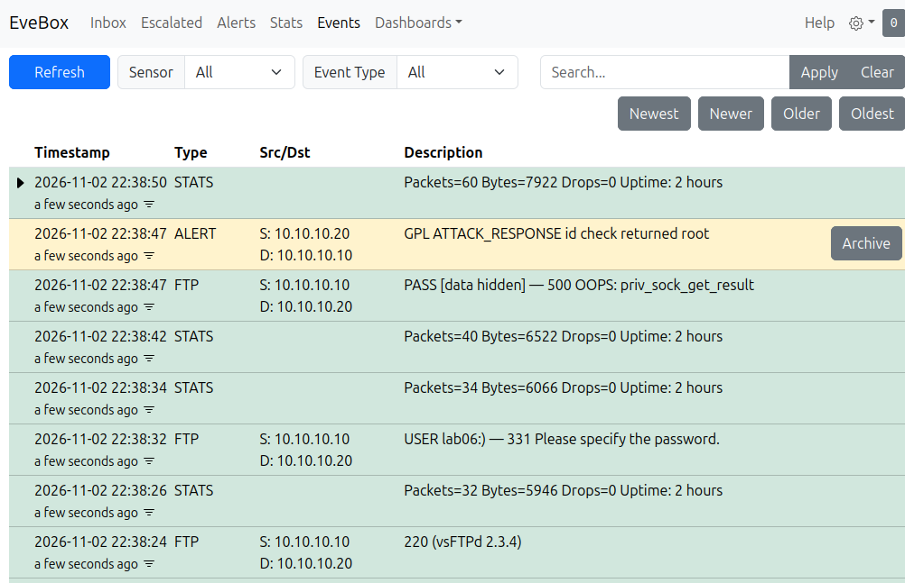

The alert identified the root command response traveling from Metasploitable 2 on port 6200 back to Kali. Although this provided evidence of suspicious command execution, the signature did not identify the FTP username that had triggered the backdoor.

#### Investigating and Enabling an Existing Signature

Following the initial test, I searched Suricata's available rules for signatures associated with vsftpd and CVE-2011-2523.

```bash
sudo grep -n -i -m 5 -E 'vsftpd|CVE-2011-2523' /var/lib/suricata/rules/suricata.rules
```

This revealed an existing Emerging Threats signature, SID `2013188` (`ET EXPLOIT VSFTPD Backdoor User Login Smiley`), which was commented out in the ruleset.

The signature was designed to identify FTP username commands containing the `:)` sequence associated with the backdoor. Unlike the generic root-response signature, it could detect the suspicious FTP request itself.

To enable it, I created `/etc/suricata/enable.conf` and added SID `2013188`. I then regenerated the ruleset using:

```bash
sudo suricata-update --offline
```

After confirming that the signature was enabled in the generated ruleset, I restarted Suricata to load the updated rules.

#### Detection Verification

I repeated the manual vsftpd exploitation attempt using Netcat and examined the resulting events in EveBox.

This time, Suricata generated two relevant alerts:

- **SID `2013188` — ET EXPLOIT VSFTPD Backdoor User Login Smiley:** Detected the crafted FTP username sent from Kali to Metasploitable 2.
- **SID `2100498` — GPL ATTACK_RESPONSE id check returned root:** Detected the root command response returned from the backdoor shell.

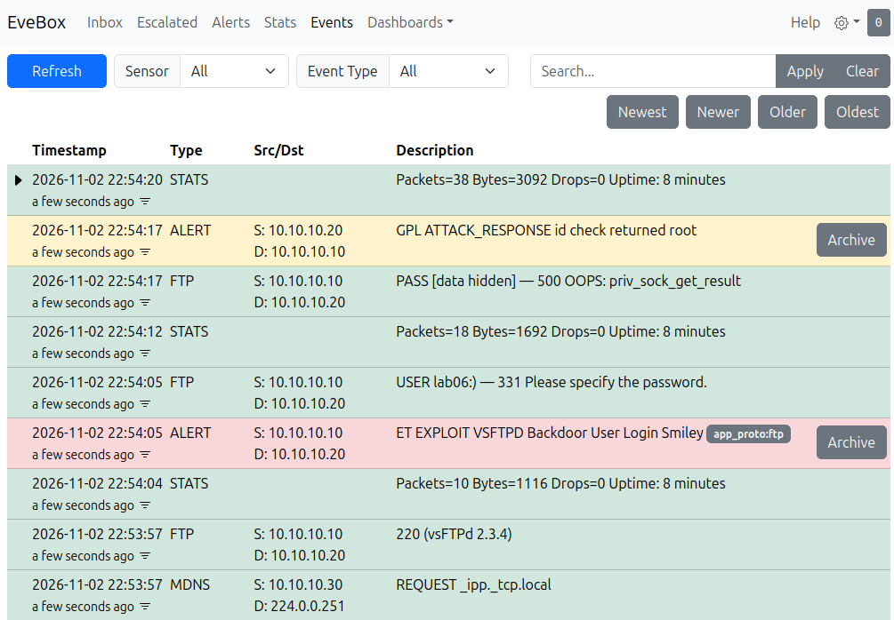

The dedicated backdoor signature triggered when the malicious FTP username was submitted, before the root-response alert appeared.

During experimentation, I also verified that the enabled backdoor signature detected the corresponding activity generated by Nmap's `ftp-vsftpd-backdoor` NSE script.

#### Detection Result

The initial testing demonstrated that Suricata could detect evidence of root command execution without identifying the FTP request responsible for activating the backdoor.

After enabling SID `2013188`, Suricata could identify the backdoor-triggering username directly, providing more specific detection of the attack.

The two signatures provided complementary information about the same exploitation attempt. Although Suricata successfully detected the activity, it did not block the attack, as intrusion prevention was outside the scope of this lab.

### 1.2 SMB - Samba Username Map Script Command Injection (CVE-2007-2447)

#### Initial Detection Testing

I began by reproducing the Samba command injection vulnerability exploited in Lab 05 to determine whether Suricata's existing rules could identify the attack.

From Kali, I used `smbclient` to submit a crafted username containing a command enclosed in backticks. Although Samba returned `NT_STATUS_LOGON_FAILURE`, the vulnerable `username map script` functionality executed the injected command before authentication completed.

I examined the resulting activity in EveBox. Suricata recorded the SMB1 negotiation and session setup events and generated a generic application-layer protocol alert, but did not specifically identify the command injection attempt.

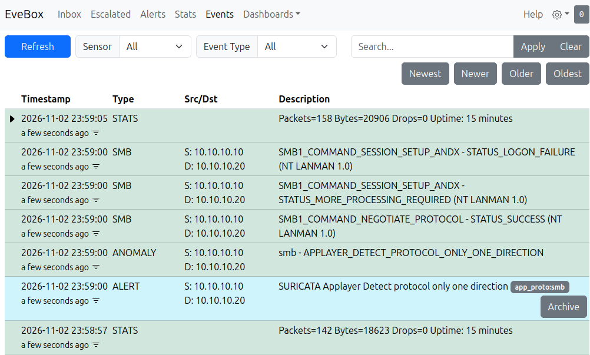

I also tested the Metasploit `usermap_script` module, which established a reverse shell on Kali. After executing `id` through the shell, Suricata generated the existing SID `2100498` alert (`GPL ATTACK_RESPONSE id check returned root`).

As with the FTP investigation, this detected evidence of root command execution without identifying the exploit responsible for obtaining access.

#### Developing a Custom Detection Signature

I searched Suricata's available rules for signatures associated with CVE-2007-2447, Samba username mapping, and command injection, but did not find a relevant signature for the vulnerability.

I therefore developed a custom signature, SID `1000001` (`LAB06 SMB Suspicious Paired Backticks in Username`).

The rule used Suricata's `smb.ntlmssp_user` keyword to inspect the username extracted from NTLMSSP authentication traffic. It looked for paired backticks, which were used to enclose the shell command in my manual exploitation attempt.

I created `/etc/suricata/rules/lab06-samba.rules` to store the custom signature and added the rule file to the `rule-files` section of `/etc/suricata/suricata.yaml`. After restarting Suricata to load the new configuration, I repeated the manual `smbclient` attack.

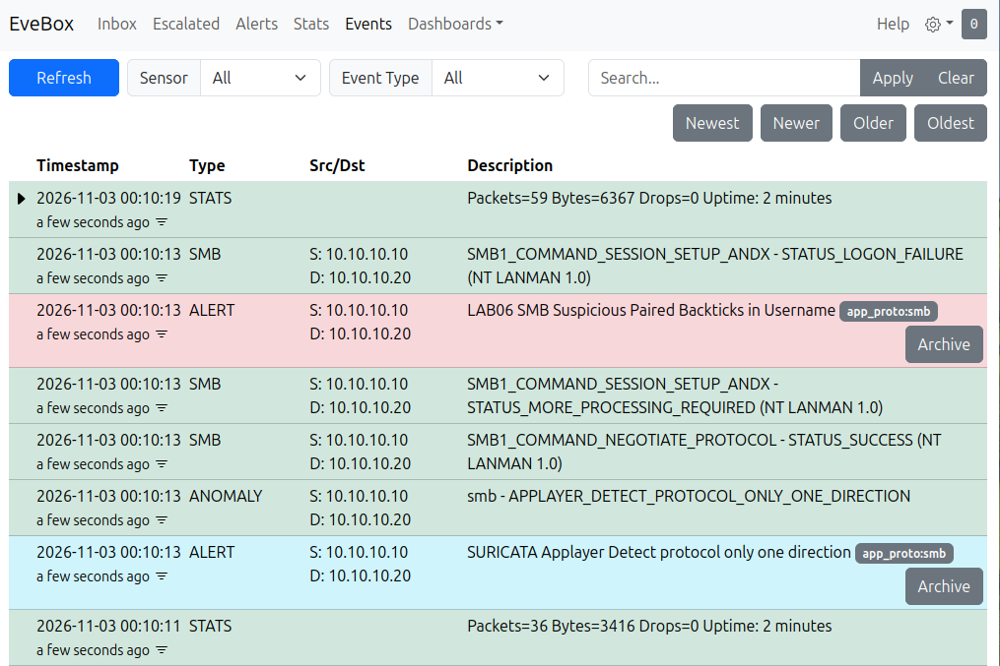

EveBox displayed an alert from SID `1000001`, confirming that the custom signature detected the suspicious username in the manual attack.

#### Investigating Metasploit Detection

I then tested the same signature against the Metasploit `usermap_script` exploit.

Unlike the manual smbclient attempt, Metasploit constructed a legacy SMB1 Session Setup request that Suricata did not extract into the smb.ntlmssp_user buffer used by my first rule.

As a result, SID `1000001` did not detect the Metasploit attack.

To address this detection gap, I searched for historical Samba detection signatures and found an older Snort rule, SID `21164`, designed to detect CVE-2007-2447 exploitation attempts.

The historical rule examined the structure of legacy SMB1 authentication requests and included matching conditions associated with the `/=` prefix used by the Metasploit exploit.

However, my testing in Lab 05 had demonstrated that the `/=` prefix was not required to exploit the vulnerability. I adapted the historical rule's SMB1 parsing approach and changed the relevant matching conditions to identify paired backticks instead.

The adapted signature was assigned SID `1000002` (`LAB06 SMB1 Legacy Username Paired Backticks`).

After loading the updated rules, I repeated the Metasploit attack.

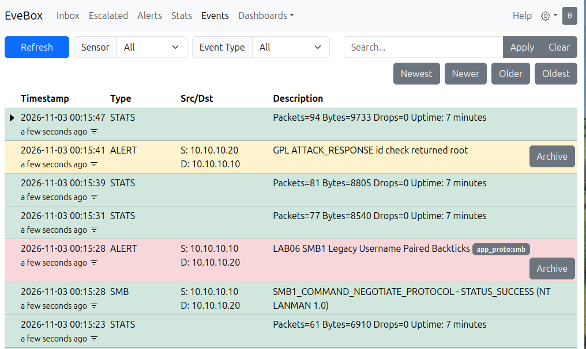

EveBox generated an alert from SID `1000002` during the malicious SMB1 request. After the reverse shell was established and I executed `id`, Suricata also generated the existing root-response alert, SID `2100498`.

This confirmed that the adapted signature detected the Metasploit exploitation method that the first custom rule had missed.

#### Detection Result and Limitations

The initial tests demonstrated that Suricata could record SMB activity and detect certain command responses without specifically identifying Samba username-map command injection.

Developing SID `1000001` provided detection for the manual `smbclient` attack, while adapting the historical Snort rule into SID `1000002` provided coverage for the legacy SMB1 request generated by Metasploit.

I also tested legitimate SMB authentication and confirmed that it did not trigger either custom signature.

However, both rules relied on specific patterns observed during the tested exploits. Other command injection techniques, including shell command substitution using `$()`, could bypass the paired-backtick matching conditions.

These signatures therefore demonstrated detection of the exploitation methods tested in this lab, rather than comprehensive coverage of every possible variation of CVE-2007-2447.

### 1.3 distcc - distccd Remote Command Execution (CVE-2004-2687)

#### Initial Detection Testing

I began by reproducing the distccd remote command execution vulnerability exploited in Lab 05 to investigate whether Suricata's existing rules could identify the attack.

From Kali, I used Nmap's `distcc-cve2004-2687` NSE script to test the vulnerability.

```bash
sudo nmap -p 3632 --script distcc-cve2004-2687 10.10.10.20
```

The script confirmed that command execution was possible under the `daemon` account.

I examined the resulting events in EveBox. Suricata generated an alert named `ET ATTACK_RESPONSE Output of id command from HTTP server`, but did not specifically identify the distccd exploitation attempt.

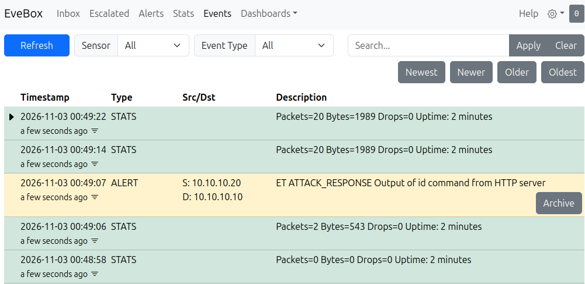

Although the alert referenced an HTTP server, the activity originated from distccd on TCP port 3632. The signature matched the returned command output without identifying the service or vulnerability responsible for it.

#### Investigating an Existing Signature

Following the initial test, I investigated available detection signatures associated with distccd and CVE-2004-2687.

I found a historical, retired signature, SID `2103061` (`GPL DELETED distccd command execution attempt`), designed to detect suspicious distcc requests.

I added the historical signature to `/etc/suricata/rules/lab06-distccd-retired.rules`, included the rule file in the `rule-files` section of `/etc/suricata/suricata.yaml`, and restarted Suricata.

I then repeated the exploitation tests using both Nmap NSE and a manually constructed distcc request.

The historical signature successfully generated alerts for both exploitation methods.

#### Investigating False Positives

To determine whether the signature could distinguish malicious requests from legitimate distcc activity, I tested normal remote compilation.

From the Ubuntu Observer, I used distcc to compile a small C source file remotely on Metasploitable 2:

```bash
DISTCC_HOSTS=10.10.10.20:3632 DISTCC_FALLBACK=0 DISTCC_NO_REWRITE_CROSS=1 DISTCC_BACKOFF_PERIOD=0 DISTCC_VERBOSE=1 distcc gcc -c ~/test.c -o ~/test.o
```

The compilation completed successfully, returning status `0` and producing the expected object file.

However, Suricata generated alerts from SID `2103061` for this legitimate compilation request.

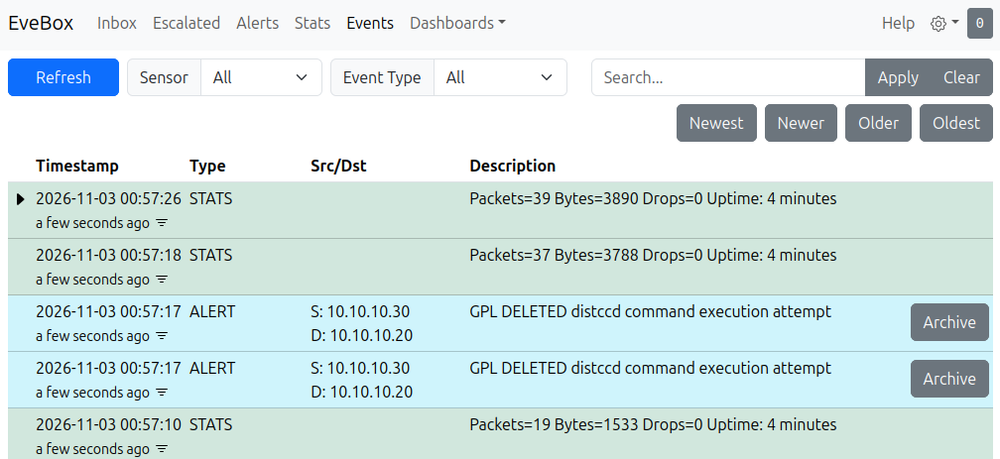

This demonstrated that the historical signature's matching conditions were too broad. It could identify distcc requests associated with exploitation, but also matched legitimate compilation traffic.

#### Developing a More Specific Signature

To reduce these false positives, I developed a custom signature, SID `1000003` (`LAB06 distccd Shell Execution Attempt`).

The historical signature matched the distcc protocol header, which was also present in legitimate requests. My custom rule retained the protocol header check but added a condition to identify a shell execution argument.

Specifically, the rule looked for `DIST00000001` followed by `ARGV00000002sh` within the beginning of the request. This combination was intended to identify the shell-based execution methods used during the Lab 05 attacks rather than ordinary compilation commands.

I stored the new signature in `/etc/suricata/rules/lab06-distccd.rules`, updated `suricata.yaml` to load it instead of the historical rule, and restarted Suricata.

I then repeated the legitimate compilation and exploitation tests.

The legitimate compilation completed successfully without triggering the custom signature. However, both the manual exploitation method and Nmap NSE generated alerts from SID `1000003`.

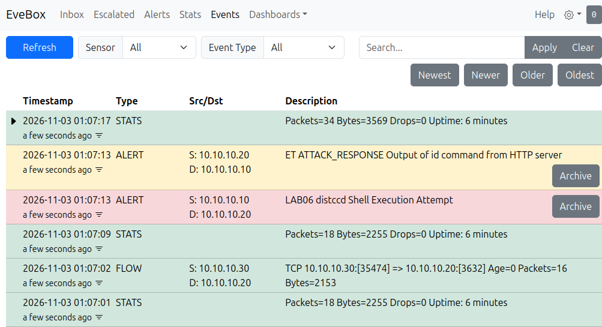

The EveBox events showed the legitimate connection from Ubuntu (`10.10.10.30`) to Metasploitable 2 on TCP port 3632 without a corresponding custom alert. The subsequent Nmap exploit from Kali (`10.10.10.10`) triggered SID `1000003`, along with the existing generic `id` response alert.

#### Detection Result and Limitations

The initial tests demonstrated that Suricata could detect suspicious command output without specifically identifying distccd exploitation.

The historical signature provided more direct detection of distccd attacks, but also generated false positives during legitimate remote compilation.

By adding a shell execution condition, SID `1000003` successfully detected both exploitation methods tested in this lab without alerting on the legitimate compilation requests.

However, the custom signature was designed around the specific shell-based request patterns observed during testing. Other methods of abusing distccd that do not contain the same argument pattern may evade this detection.

The investigation demonstrated the importance of testing detection signatures against both malicious and legitimate traffic to evaluate their accuracy and limitations.

### 1.4 HTTP - DVWA SQL Injection (Low Security)

#### Detection Testing

I reproduced the SQL injection vulnerability exploited in Lab 05 and examined the resulting activity in EveBox.

The injection successfully returned multiple user records, but Suricata did not generate an alert specifically identifying the attack.

I investigated the available Suricata signatures but did not find a relevant rule for the SQL injection tested.


#### Detection Result and Limitations

The testing identified a gap in Suricata's detection coverage for the SQL injection techniques used in Lab 05.

Unlike the more specific attack patterns investigated in the previous sections, SQL injection can involve different payload structures, encoding techniques, and application behavior. Developing and testing custom signatures to cover the SQL injection techniques demonstrated in Lab 05 would have required a more extensive investigation than the previous custom rules, so I left that work outside the scope of this lab.

### 1.5 NFS - Insecure Export Configuration

#### Initial Detection Testing

I reproduced the insecure NFS export exploitation demonstrated in Lab 05 to investigate whether Suricata could detect the activity.

From Kali, I mounted Metasploitable 2's exported root filesystem using NFSv3 and created a file in the remote `/root` directory. The operation succeeded because the export allowed unrestricted client access and used `no_root_squash`, preserving the client's root privileges.

I examined the resulting events in EveBox. Suricata recorded NFS operations, including `ACCESS`, `LOOKUP`, and `CREATE`, along with information about the affected files and operation results.

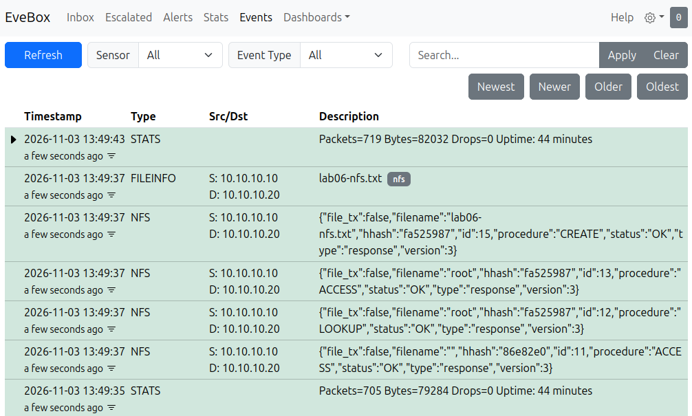

Suricata also generated generic RPC portmapper alerts, but these did not specifically identify the insecure export configuration or the root-level file creation.

#### Investigating Detection Coverage

I searched Suricata's available signatures for rules related to insecure NFS exports and `no_root_squash`, but did not find a relevant signature for the misconfiguration.

Although Suricata could observe NFS file operations, these events alone did not establish whether the activity was authorized. Legitimate NFS clients also perform operations such as file creation and modification.

A custom signature could have been developed to alert on particular NFS operations or client addresses, but this would not reliably distinguish exploitation of the insecure export from legitimate activity.

#### Detection Result and Limitations

The investigation demonstrated that Suricata provided visibility into NFS activity without identifying the underlying export misconfiguration.

Detecting the misuse of `no_root_squash` through network traffic would require additional context about the server's configuration and intended access permissions. Rather than creating a broad signature that could produce false positives during normal NFS activity, I focused on correcting the export configuration and verifying the results in Section 2.5.

## 2. Mitigation, Remediation, and Retesting

### 2.1 FTP - vsftpd 2.3.4 Backdoor (CVE-2011-2523)

#### Firewall Restrictions

I began by restricting network access to the vulnerable FTP service using `iptables`.

Before applying the firewall rules, Kali could connect to TCP port 21, while the backdoor port 6200 was closed because it had not been triggered. The Ubuntu Observer could also connect to FTP and receive the vsftpd banner.

I added an `ACCEPT` rule permitting the trusted Ubuntu Observer (`10.10.10.30`) to access TCP port 21. I then added a `REJECT` rule using the `multiport` extension to block other clients from accessing ports 21 and 6200.

After applying the rules, I repeated the connection tests. Kali reported both ports as closed, while Ubuntu could still connect to port 21 and receive the FTP banner.

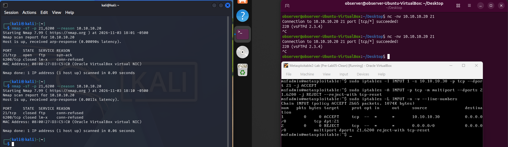

This demonstrated that the firewall could restrict access to the vulnerable service while preserving access for an authorized client.

#### Disabling the Vulnerable Service

Although the firewall restricted network access, the backdoored version of vsftpd remained installed and accessible to the permitted client.

To remove this remaining network exposure, I edited `/etc/xinetd.d/vsftpd` and changed `disable = no` to `disable = yes`. I then restarted xinetd to apply the configuration change.

I repeated the connection tests from both systems. Kali continued to report ports 21 and 6200 as closed, while Ubuntu's previously successful FTP connection was now refused.

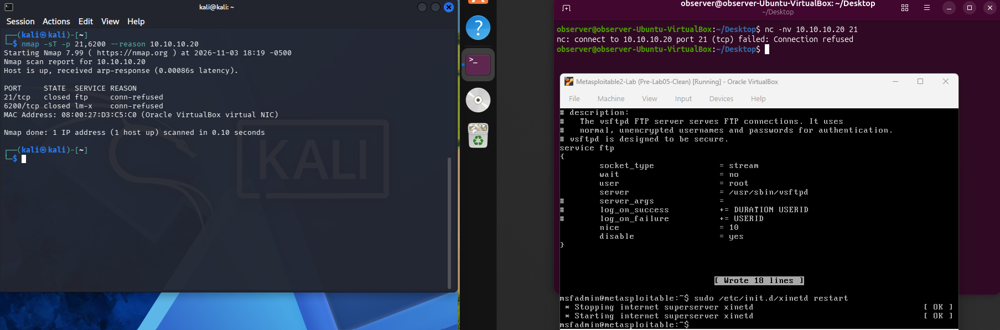

#### Mitigation Result and Limitations

The firewall rules successfully restricted access to FTP, and disabling vsftpd prevented connections even from the previously permitted client.

These changes reduced exposure to the backdoor but did not remove the compromised software. If FTP functionality were required, the backdoored installation would need to be removed and replaced with a trusted, supported version.

Firewall rule persistence after reboot is addressed in Section 2.6.

### 2.2 SMB - Samba Username Map Script Command Injection (CVE-2007-2447)

#### Vulnerable Configuration and Initial Testing

I began by verifying that Samba's `username map script` option was enabled in `/etc/samba/smb.conf`.

I reproduced the manual command injection from Lab 05 by sending a crafted SMB username containing a backtick-enclosed command to TCP port 139.

Although Samba returned `NT_STATUS_LOGON_FAILURE`, the injected command executed before authentication failed. I confirmed this by checking that the command had created a root-owned proof file in `/tmp`.

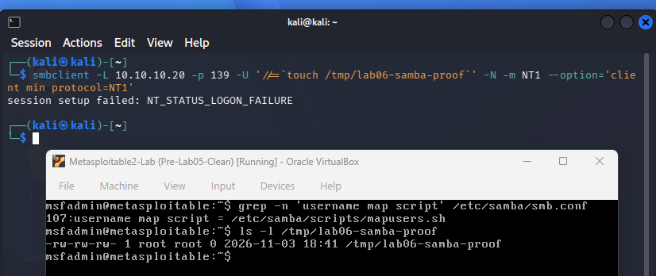

#### Disabling the Vulnerable Configuration

I removed the proof file, commented out the `username map script` directive in `/etc/samba/smb.conf`, and restarted Samba to apply the configuration change.

I then repeated the same command injection from Kali. Samba again returned `NT_STATUS_LOGON_FAILURE`, but the proof file was not recreated, indicating that the injected command had not executed.

To verify that legitimate functionality remained available, I authenticated to Samba using the `msfadmin` account and successfully listed the available shares.

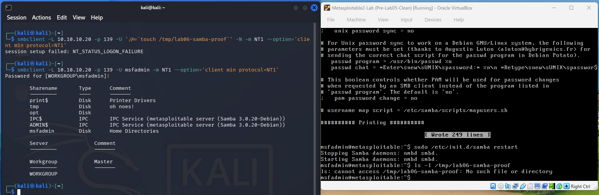

#### Mitigation Result and Limitations

Disabling `username map script` prevented the demonstrated command injection while preserving legitimate Samba access.

Unlike the FTP mitigation, this change addressed the specific vulnerable configuration without requiring the service to be disabled or restricted by firewall rules.

However, the legacy Samba version remained installed. A supported, patched version would still be recommended to address vulnerabilities in the underlying software.

### 2.3 distcc - distccd Remote Command Execution (CVE-2004-2687)

#### Vulnerable Configuration and Initial Testing

I began by verifying that distccd was running with `--allow 0.0.0.0/0`, allowing connections from any client address.

I reproduced the remote command execution vulnerability using Nmap's `distcc-cve2004-2687` script. The exploit successfully executed `id` on Metasploitable 2 and returned the daemon account information.

I also tested legitimate distributed compilation from the Ubuntu Observer. The compilation completed successfully with an exit code of `0` and produced the expected object file.

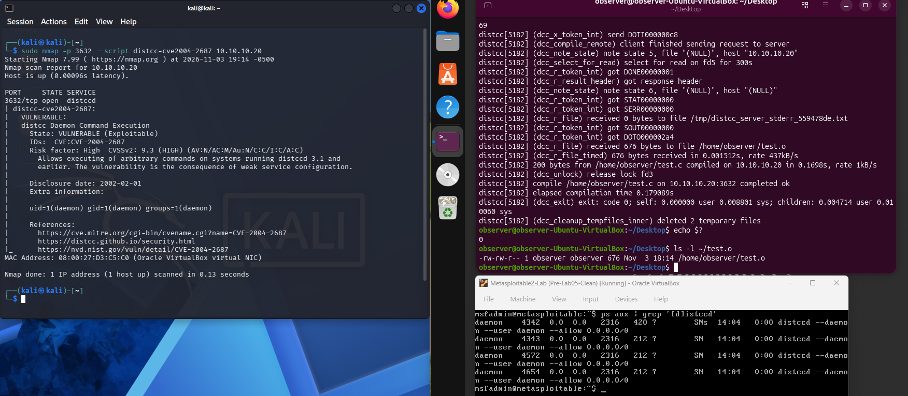

#### Restricting Authorized Clients

I first changed the `ALLOWEDNETS` setting in `/etc/default/distcc` to restrict access to the trusted Ubuntu Observer (`10.10.10.30`).

During experimentation, I discovered that this setting did not affect the running daemon because Metasploitable's `/etc/init.d/distcc` startup script explicitly launched distccd with `--allow 0.0.0.0/0`.

I modified the startup script to use `--allow 10.10.10.30`. Because the script did not implement normal stop and restart operations, I terminated the existing distccd processes and started the service again. I then verified that the running processes used the restricted client address.

After this change, Kali's Nmap exploit no longer produced successful command execution, although TCP port 3632 remained open. Ubuntu's legitimate compilation continued to succeed.

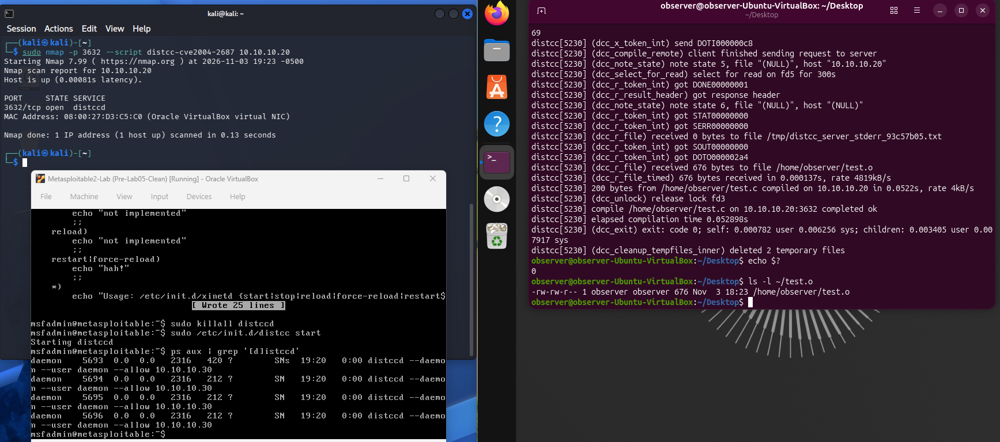

#### Firewall Restrictions

I added `iptables` rules to provide an additional layer of access control. The first rule allowed the trusted Ubuntu Observer to connect to TCP port 3632, while the second rejected connections from other clients.

I repeated the Nmap exploit from Kali, which now reported port 3632 as closed without executing the command.

I also repeated the distributed compilation from Ubuntu. The compilation completed successfully with an exit code of `0`, confirming that authorized functionality remained available.

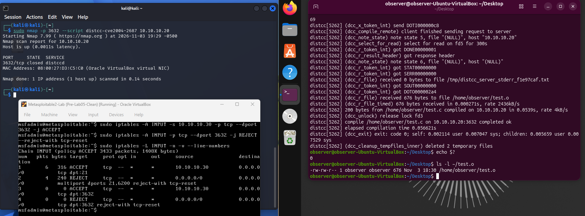

#### Mitigation Result and Limitations

The service-level restrictions prevented Kali from executing commands through distccd while preserving legitimate compilation from Ubuntu. The firewall provided an additional layer of protection by blocking Kali's connection to the service entirely.

However, these changes relied on client IP restrictions rather than authenticated access. The distcc security documentation recommends SSH transport when the network cannot be trusted, providing authenticated and encrypted connections instead of relying on the unauthenticated TCP daemon.

SSH transport was not implemented in this lab. The tested mitigations focused on preventing access from the unauthorized attacker system while preserving functionality for the trusted client.

Firewall rule persistence after reboot is addressed in Section 2.6.

### 2.4 HTTP - DVWA SQL Injection (Low Security)

#### Recommended Remediation

The SQL injection vulnerability demonstrated in Lab 05 resulted from DVWA incorporating user-controlled input directly into a SQL query.

The recommended remediation is to use parameterized queries, also known as prepared statements, with bound parameters.

Instead of combining user input directly with SQL command text, prepared statements define the query structure separately from the supplied values. The application then binds user input as parameters, allowing the database to treat those values as data rather than executable SQL.

This prevents malicious input from changing the intended structure of the SQL query.

#### Remediation Scope

Implementing this fix would require modifying DVWA's PHP application code to use prepared statements and bound parameters.

Application-level code remediation was outside the scope of this lab, so I did not modify DVWA or perform post-remediation testing. The SQL injection vulnerability therefore remained unresolved in the lab environment.

### 2.5 NFS - Insecure Export Configuration

#### Vulnerable Configuration and Initial Testing

I began by verifying the insecure NFS export configuration demonstrated in Lab 05.

Metasploitable 2 exported its entire root filesystem (`/`) to all clients using `*` and had `no_root_squash` enabled, allowing remote clients to retain root privileges when accessing the export.

From Kali, I mounted the exported filesystem using NFSv3 and created a file in the remote `/root` directory. I verified on Metasploitable that the file existed, was owned by root, and contained the expected text.

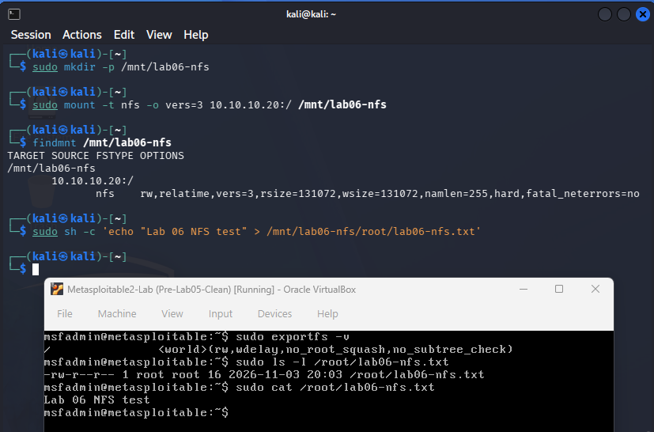

#### Enabling Root Squashing

I first removed the test file and changed the export configuration in `/etc/exports`, replacing `no_root_squash` with `root_squash`.

I applied the updated configuration using `exportfs -ra` and verified the active export using `exportfs -v`.

I repeated the NFS mount from Kali and attempted to create the same file in the remote `/root` directory.

The mount succeeded, but the file creation returned `Permission denied`. This demonstrated that `root_squash` mapped Kali's root privileges to an unprivileged account on the NFS server, preventing the file creation.

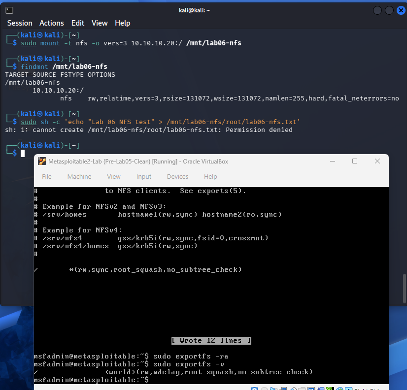

#### Restricting Authorized Clients

Although root squashing prevented the demonstrated root-level write, the entire filesystem remained exported to all clients.

I modified `/etc/exports` to replace the `*`, which permitted access from all clients, with the trusted Ubuntu Observer's IP address (`10.10.10.30`).

After applying the configuration, I attempted to mount the export from both Kali and Ubuntu.

Kali's mount request was denied by the server, while Ubuntu successfully mounted the export. I verified the authorized mount using `findmnt`.

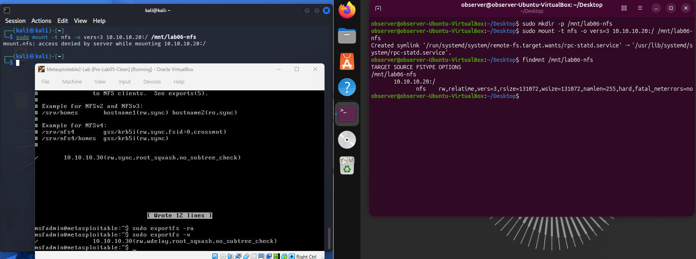

#### Restricting the Exported Directory

Although access was now limited to the trusted client, exporting the entire root filesystem remained unnecessary.

I created a dedicated directory at `/srv/lab06-nfs` and assigned ownership to the `msfadmin` account to permit legitimate file operations.

I then replaced the root filesystem export with the dedicated directory, retaining the trusted-client restriction and `root_squash` setting.

After applying the changes, I verified that Ubuntu could no longer mount the original root filesystem export.

Ubuntu successfully mounted `/srv/lab06-nfs`, created a test file, and read its contents. I also verified that the file existed in the dedicated directory on Metasploitable.

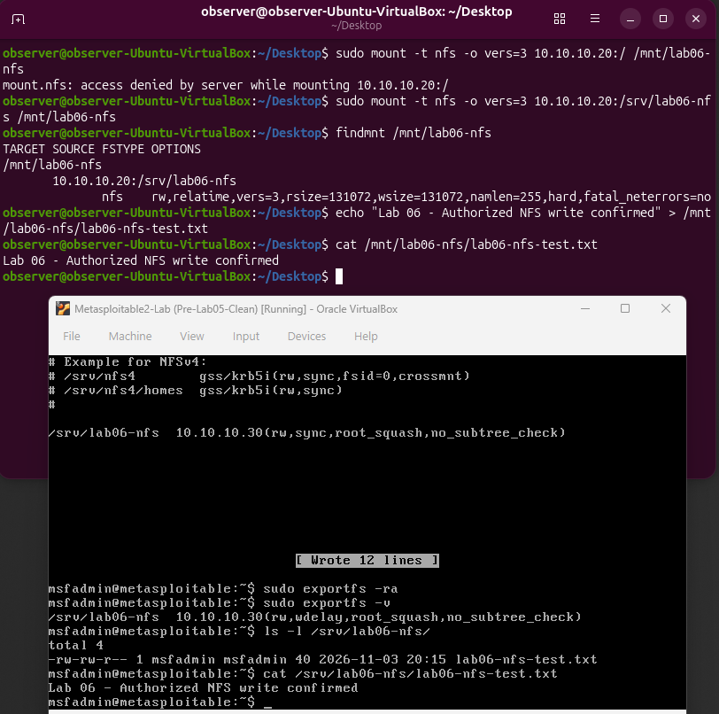

#### Mitigation Result and Limitations

The configuration changes addressed the insecure NFS export through three separate controls: root squashing, client access restrictions, and limiting the exported filesystem to a dedicated directory.

Kali could no longer mount the export, while Ubuntu retained access to the authorized directory and could perform legitimate file operations.

These changes corrected the demonstrated misconfiguration without requiring additional firewall rules. However, the configuration still relied on client IP restrictions rather than authenticated NFS access.

### 2.6 Persistence Verification

#### Initial Reboot Testing

After applying the service configuration changes and firewall restrictions, I rebooted Metasploitable 2 to determine whether the mitigations remained effective.

I verified that the changes to vsftpd, Samba, distccd, and the NFS export configuration remained in place.

However, the `iptables` rules configured during the earlier mitigation tests were no longer present after reboot. The rules had been applied to the running firewall but were not configured to load automatically when the system started.

#### Configuring Persistent Firewall Rules

To address this issue, I added the firewall rules to `/etc/rc.local` so they would be applied automatically during startup.

During experimentation, an initial startup attempt using the `multiport` rule encountered an issue that prevented the firewall configuration from loading as intended. I did not determine the exact cause of the startup issue.

I replaced the combined `multiport` rule with separate port-specific rules while retaining the original access restrictions.

The final configuration contained five rules:

- Allow the trusted Ubuntu Observer (`10.10.10.30`) to access FTP on TCP port 21.
- Reject other connections to TCP port 21.
- Reject connections to the vsftpd backdoor port 6200.
- Allow Ubuntu to access distccd on TCP port 3632.
- Reject other connections to TCP port 3632.

I placed these rules in `/etc/rc.local` before the existing `exit 0` statement.

#### Verification After Reboot

I rebooted Metasploitable again and examined the active firewall rules using `iptables`.

All five rules were present after startup, confirming that the firewall restrictions now persisted across reboots.

I then scanned TCP ports 21, 6200, and 3632 from Kali. All three ports were reported as closed.

Finally, I repeated the legitimate distributed compilation test from Ubuntu. The compilation completed successfully with an exit code of `0` and produced the expected object file.

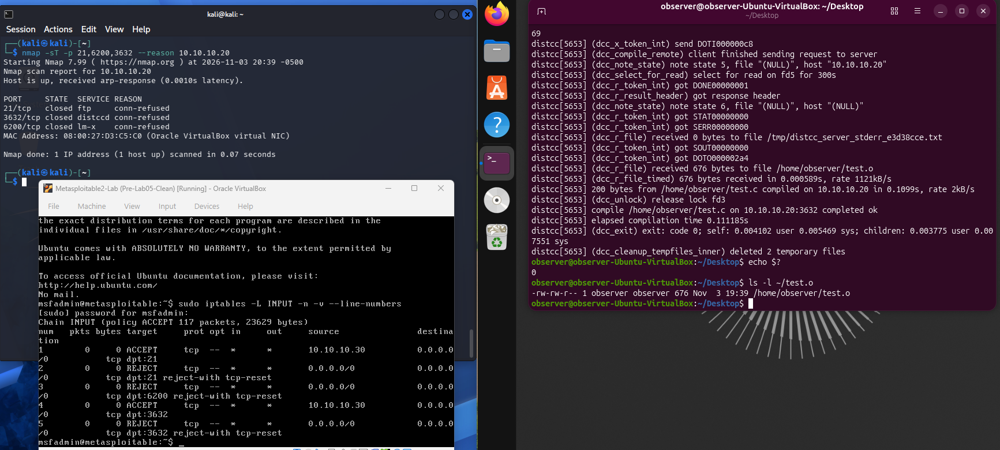

#### Persistence Result

The final testing confirmed that the service configuration changes and firewall restrictions remained effective after rebooting Metasploitable.

The attacker system remained blocked from the restricted services, while the trusted Ubuntu client retained its authorized distccd functionality.

## 3. Findings

The detection and mitigation testing produced the following findings:

| Vulnerability | Detection Findings | Mitigation Findings |
|---|---|---|
| vsftpd 2.3.4 Backdoor | Enabling an existing Suricata signature provided specific detection of the backdoor attempt. | Firewall restrictions controlled access, and disabling vsftpd prevented further connections. The backdoored software remained installed. |
| Samba Username Map Script | Two custom signatures detected the manual and Metasploit exploitation methods tested. | Disabling `username map script` prevented the demonstrated command injection while preserving legitimate Samba functionality. |
| distccd Remote Command Execution | A historical signature generated false positives during legitimate compilation. A more specific custom signature detected the tested attacks without those false positives. | Service-level client restrictions and firewall rules blocked Kali while allowing Ubuntu to continue compiling. SSH transport remained a recommended improvement. |
| DVWA SQL Injection | Suricata did not generate a specific alert for the tested SQL injection. | Prepared statements were identified as the recommended remediation, but application code changes were outside the lab's scope. |
| Insecure NFS Export | Suricata recorded NFS activity but did not identify the underlying export misconfiguration. | Enabling `root_squash`, restricting permitted clients, and exporting only a dedicated directory corrected the demonstrated misconfiguration. |

The testing demonstrated that detecting suspicious activity and preventing exploitation are separate defensive tasks. Suricata provided visibility into several attacks, but the actual mitigations required changes to service configurations, firewall rules, or access controls.

The custom detection signatures were evaluated against the specific attack methods used in this lab and should not be considered comprehensive coverage of every possible exploitation technique.

## Result

This lab built on the controlled exploitation performed in Lab 05 by investigating intrusion detection and mitigation for the five vulnerabilities.

Using Suricata and EveBox, I evaluated existing detection signatures, enabled a relevant vsftpd signature, and developed or adapted custom rules for Samba and distccd. I also identified detection gaps involving DVWA SQL injection and the insecure NFS export configuration.

I implemented and tested defensive changes for vsftpd, Samba, distccd, and NFS. These changes prevented the demonstrated attacks from Kali while preserving legitimate functionality where applicable. I also verified that the service configurations and firewall restrictions remained effective after rebooting Metasploitable 2.

The DVWA SQL injection vulnerability remained unresolved because application-level remediation was outside the scope of this lab.

Overall, the lab demonstrated how intrusion detection, service configuration, and network access controls can work together to identify malicious activity and reduce exposure to exploitable vulnerabilities.

## What I Learned

This lab helped me better understand the relationship between intrusion detection and vulnerability mitigation. I learned that identifying suspicious network activity does not necessarily mean an attack can be prevented, and that detecting a vulnerability often requires different information than detecting the activity associated with its exploitation.

Working with Suricata and EveBox gave me experience investigating detection signatures, examining alerts, and developing custom rules. The Samba testing demonstrated how different implementations of the same exploit can require different detection approaches, while the distccd testing showed the importance of testing signatures against legitimate traffic to identify false positives.

I also gained experience implementing defensive controls while preserving authorized functionality. Restricting FTP and distccd access with firewall rules, disabling Samba's vulnerable configuration, and correcting the NFS export demonstrated different ways to reduce exposure without necessarily disabling every affected service.

Troubleshooting the distccd configuration showed me why it is important to verify how a service actually starts and which settings it uses. The firewall persistence testing also demonstrated why security changes should be verified after reboot rather than assuming they remain active.

Finally, the DVWA and NFS investigations helped me understand the limitations of network-based detection. Some weaknesses are better addressed through application code changes or direct configuration inspection than through broad detection signatures that may also alert on legitimate activity.

Overall, this lab provided experience combining detection rule development, network traffic analysis, service configuration, access controls, and verification testing to investigate and mitigate security vulnerabilities.

## References

### Intrusion Detection and Rule Development

- [Suricata - Rules Documentation](https://docs.suricata.io/en/suricata-8.0.0/rules/) - Documents Suricata rule syntax, matching conditions, and signature options used during custom rule development.
- [Suricata - Rule Management with Suricata-Update](https://docs.suricata.io/en/suricata-8.0.0/rule-management/suricata-update.html) - Explains managing existing rules, enabling disabled signatures through `enable.conf`, and regenerating the ruleset.
- [Suricata - Adding Your Own Rules](https://docs.suricata.io/en/suricata-8.0.0/rule-management/adding-your-own-rules.html) - Documents creating custom rule files and loading them through `suricata.yaml`.
- [Suricata - SMB Keywords](https://docs.suricata.io/en/suricata-8.0.0/rules/smb-keywords.html) - Documents the `smb.ntlmssp_user` keyword used to inspect usernames during Samba detection testing.
- [Suricata - EVE JSON Output](https://docs.suricata.io/en/suricata-8.0.0/output/eve/eve-json-output.html) - Explains the structured alerts, protocol events, and file information recorded in `eve.json`.
- [EveBox - SQLite Documentation](https://evebox.org/docs/server/sqlite/) - Documents the SQLite backend used to store and review Suricata events through EveBox.

### Detection Signature Research

- [Emerging Threats - vsftpd Backdoor Signature (SID 2013188)](https://community.emergingthreats.net/t/ruleset-update-summary-2026-09-07-v11277/3441) - Identifies the existing `ET EXPLOIT VSFTPD Backdoor User Login Smiley` signature enabled during FTP detection testing.
- [Historical Snort - server-samba.rules](https://github.com/John-Lin/docker-snort/blob/master/snortrules-snapshot-2972/rules/server-samba.rules) - Archived Snort ruleset containing SID `21164`, examined when developing the adapted custom signature for legacy SMB1 requests.
- [Snort - distccd Remote Command Execution Detection (SID 3061)](https://www.snort.org/rule_docs/1-3061) - Documents a historical distccd detection signature and its false-positive considerations, providing background for the retired GPL signature investigated during testing.

### Vulnerability Mitigation and Testing

- [Samba - Security Advisory CVE-2007-2447](https://www.samba.org/samba/security/CVE-2007-2447.html) - Documents the username map script command injection vulnerability and affected Samba configurations.
- [distcc - Security Notes](https://www.distcc.org/security.html) - Explains the risks of unrestricted distccd access, client restrictions, firewall controls, and the recommendation to use SSH transport.
- [OWASP - SQL Injection Prevention Cheat Sheet](https://cheatsheetseries.owasp.org/cheatsheets/SQL_Injection_Prevention_Cheat_Sheet.html) - Explains prepared statements and parameterized queries as recommended protections against SQL injection.
- [Linux - exports(5) Manual](https://man7.org/linux/man-pages/man5/exports.5.html) - Documents NFS export permissions, authorized client restrictions, `root_squash`, and `no_root_squash`.
- [Linux - exportfs(8) Manual](https://man7.org/linux/man-pages/man8/exportfs.8.html) - Documents applying and inspecting NFS export configurations using `exportfs`.
- [Linux - iptables(8) Manual](https://man7.org/linux/man-pages/man8/iptables.8.html) - Documents firewall rule configuration, packet matching, and `ACCEPT` and `REJECT` actions used during mitigation.

